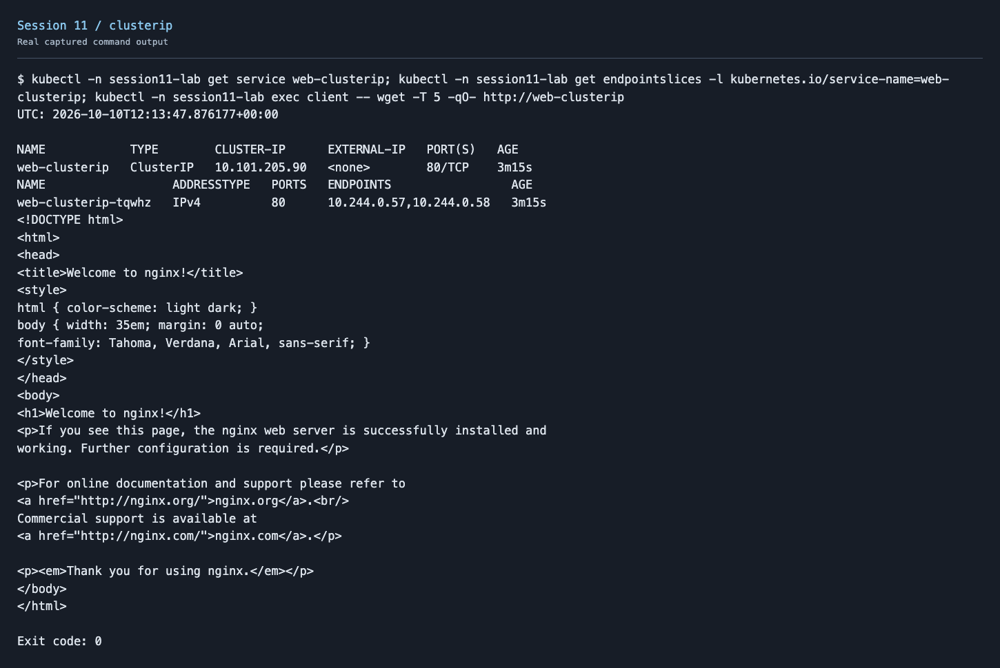
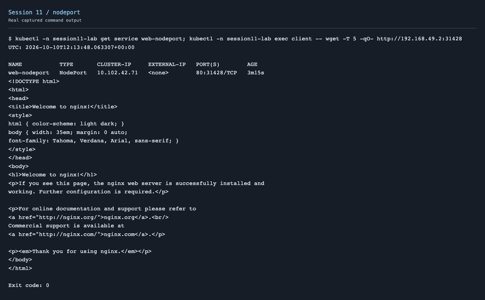
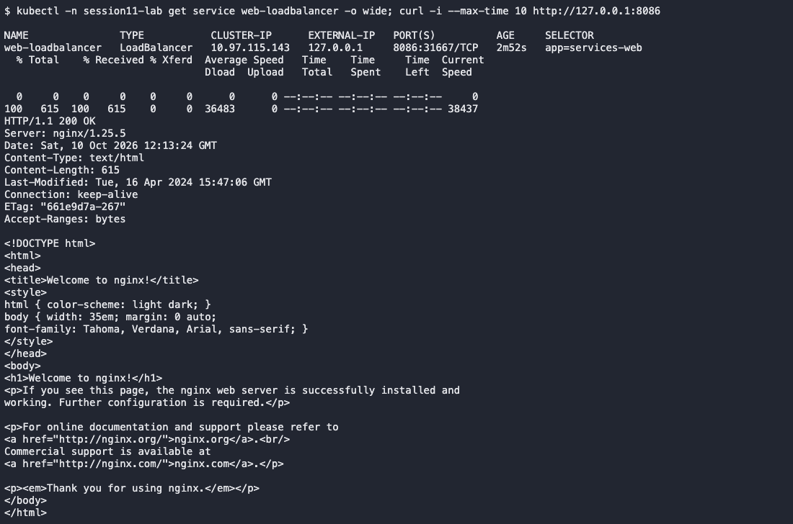
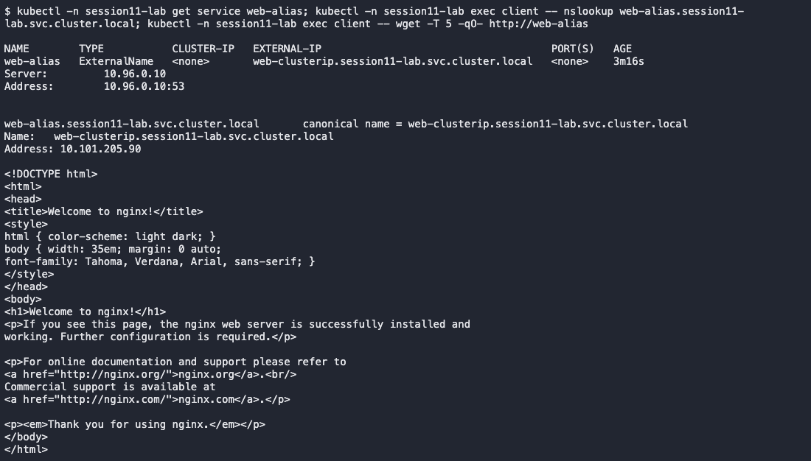
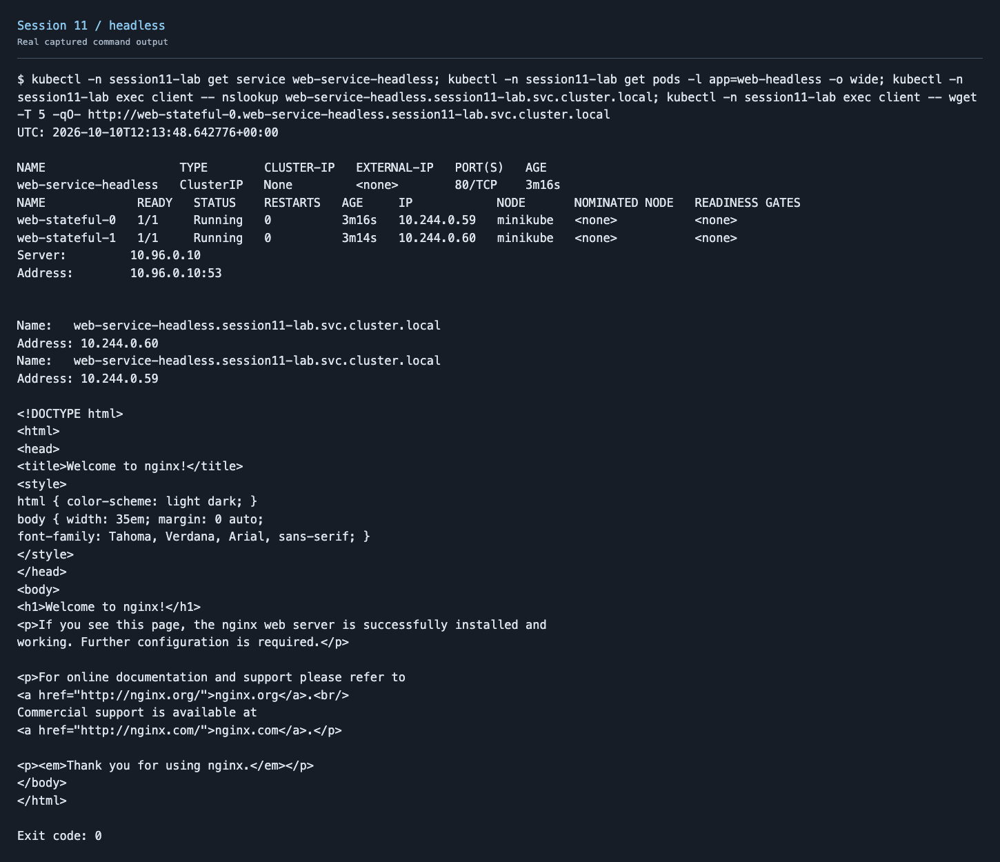
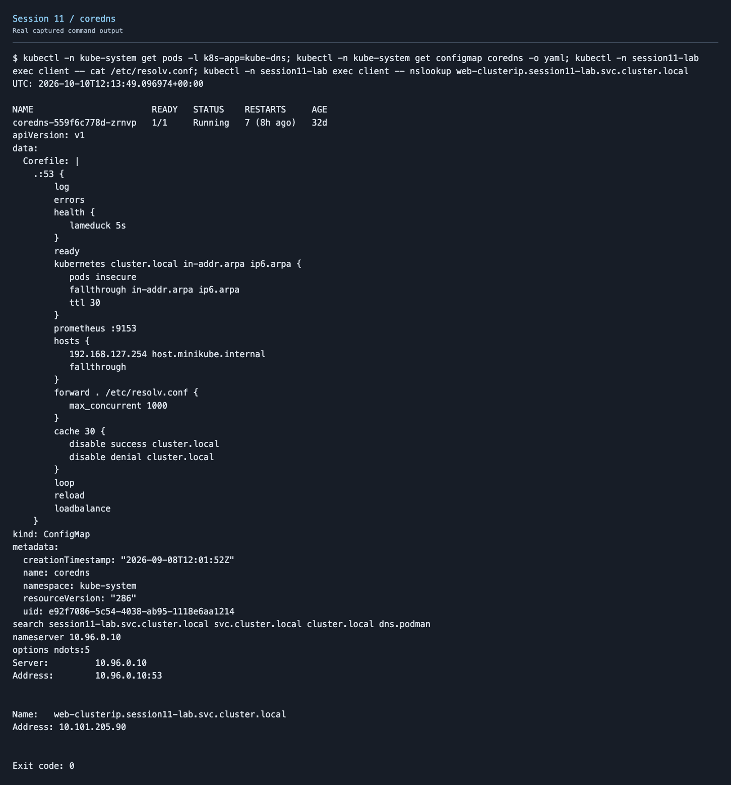

# Session 11 - Kubernetes Networking & Services

Deployed the five Service types in `session11-lab` using Nginx. Tested internal access from a client Pod and used a Minikube tunnel to access the LoadBalancer from my Mac.

## Services

| Service | What happened | Evidence |
| --- | --- | --- |
| ClusterIP | Internal Service DNS and ClusterIP returned the page | [Output](screenshots/clusterip.txt) |
| NodePort | Request to the node IP and allocated NodePort returned the page | [Output](screenshots/nodeport.txt) |
| LoadBalancer | Real external IP 127.0.0.1:8086 returned HTTP 200 through Minikube tunnel | [Output](screenshots/loadbalancer.txt) |
| ExternalName | CNAME alias resolved and its target returned the page | [Output](screenshots/externalname.txt) |
| Headless | clusterIP=None; DNS returned Pod IPs and the StatefulSet Pod FQDN was reachable | [Output](screenshots/headless.txt) |

[Executed YAML files](homework/)

```bash
kubectl create namespace session11-lab
kubectl apply -f homework/
kubectl -n session11-lab get services,pods
minikube tunnel --bind-address=127.0.0.1
# In another terminal:
curl http://127.0.0.1:8086
```

ExternalName points to a controlled Service FQDN for this reproducible exercise. It creates a DNS alias, not a proxy or a new ClusterIP. An external domain can be used instead.

Used port 8086 for the LoadBalancer to avoid binding to a privileged port. The tunnel asked for sudo for other Ingress objects, but the LoadBalancer page worked on 8086 without it.











## Deployment vs ReplicaSet

| Topic | Deployment | ReplicaSet |
| --- | --- | --- |
| Purpose | Manages application releases | Maintains the desired number of matching Pods |
| Pod management | Creates/manages ReplicaSets | Creates replacement Pods when replicas are missing |
| Scaling | Changes the desired replicas through its ReplicaSet | Maintains its configured replica count |
| Rolling updates | Creates a new ReplicaSet and gradually changes old/new replica counts | Does not orchestrate application-version rollouts |
| Relationship | Owns ReplicaSets | Usually owned by a Deployment |

Use a Deployment for normal stateless application releases instead of managing its ReplicaSets manually.

## Deployment vs DaemonSet vs StatefulSet

| Topic | Deployment | DaemonSet | StatefulSet |
| --- | --- | --- | --- |
| Use | Stateless web/API replicas | Agents on eligible nodes | Applications needing stable identities/storage |
| Pod creation | Interchangeable replicas | One per eligible node | Stable ordinal names, usually ordered |
| Scaling | Desired replica count | Follows eligible node count | Desired ordinal replica count |
| Networking | Usually a normal Service | Often node-local access | Often headless Service and stable DNS names |
| Storage | Ephemeral volumes or suitable PVCs | Often node-local volumes | Often per-Pod PVCs through volumeClaimTemplates |
| Example | Nginx API | Log collector/node exporter | PostgreSQL/Kafka cluster |

StatefulSet identity is stable; its Pod IP can still change after replacement.

## ReplicaSet vs Service

A ReplicaSet maintains Pod count and replaces missing Pods. A Service supplies a stable discovery/connection endpoint and selects eligible backends. Traffic reaches a Service address/port, then is forwarded to a selected endpoint's targetPort. Scaling a ReplicaSet does not itself provide Service discovery or an external endpoint.

## DNS and CoreDNS

[FQDN documentation](fqdn/README.md) · [CoreDNS notes and configuration](coredns/README.md)



## Cleanup

```bash
kubectl delete namespace session11-lab
```

Stopped the tunnel and deleted the homework namespace after testing. [Cleanup output](screenshots/cleanup.txt).
