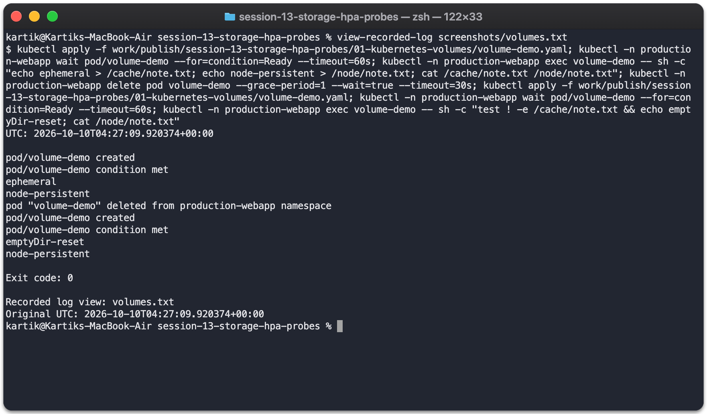
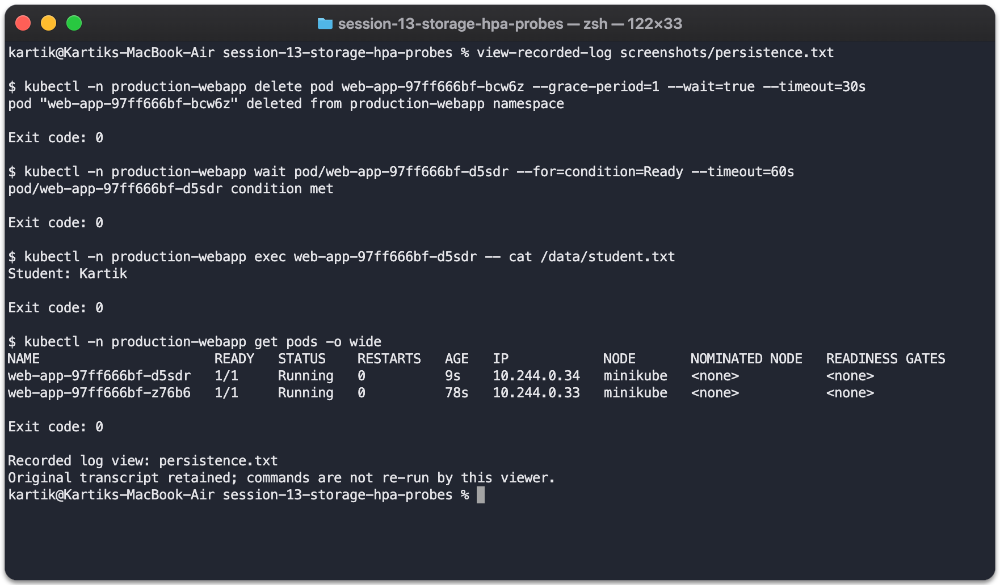

# Kubernetes Volumes

Container files are temporary. Kubernetes volumes let containers share data or keep it beyond a container's lifetime.

| Type | Lifetime and use |
| --- | --- |
| emptyDir | Created for a Pod, shared by its containers and removed when that Pod is deleted. Useful for temporary files and caches |
| hostPath | Mounts a path from the node. Data can survive Pod replacement on that node; it is tied to that node and gives access to its filesystem |
| PersistentVolume (PV) | Cluster storage resource provisioned manually or by a storage provisioner |
| PersistentVolumeClaim (PVC) | A workload's request for storage, including size, access mode and StorageClass |
| StorageClass | Defines the provisioner and storage/reclaim settings used for claims |
| Dynamic provisioning | A PVC causes a compatible provisioner to create and bind a PV automatically |

```text
Pod → volumeMount → PVC → PV → backing storage
                      ↓
                 StorageClass / provisioner
```

## Practical examples

[emptyDir + hostPath example](volume-demo.yaml) was executed in `production-webapp`. I wrote one file to each volume, deleted the Pod and recreated it. The emptyDir file disappeared; the hostPath file remained.



[Complete commands and output](../screenshots/volumes.txt)

The [mini-project PVC](../mini-project/pvc.yaml) requested 500Mi from Minikube's `standard` StorageClass. The provisioner dynamically created a PV and the claim became Bound. A file written to `/data` survived deletion and replacement of the application Pod.



[Persistence output](../screenshots/persistence.txt)

ReadWriteOnce permits read/write mounting on one node; multiple Pods on that same node can use it. This demo is single-node. It does not demonstrate multi-node shared storage. The StorageClass uses Delete reclaim policy, so deleting the claim removes its dynamically provisioned volume.

References: [Volumes](https://kubernetes.io/docs/concepts/storage/volumes/), [Persistent volumes](https://kubernetes.io/docs/concepts/storage/persistent-volumes/), [Dynamic provisioning](https://kubernetes.io/docs/concepts/storage/dynamic-provisioning/).
