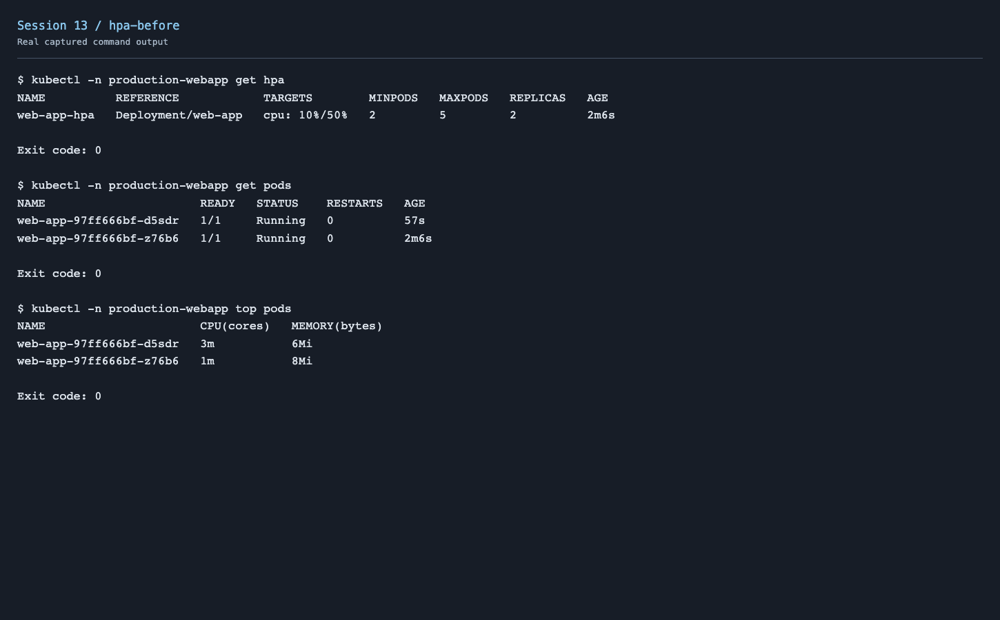
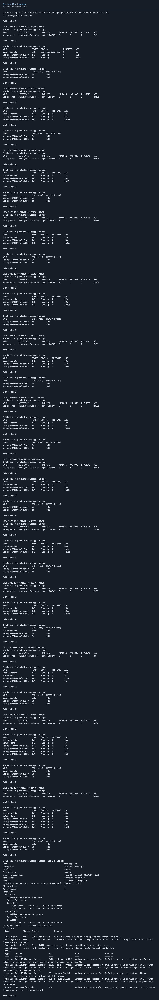
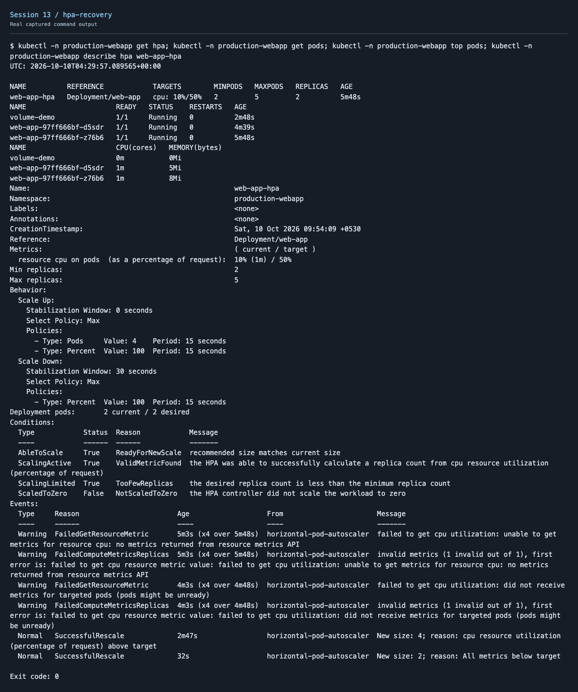
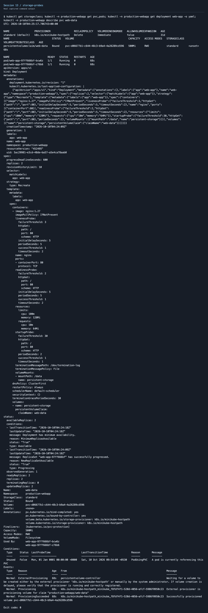

# Session 13 - Kubernetes Storage, HPA & Probes

I completed the supplied Nginx mini-project in local Minikube, using the `production-webapp` namespace. It combines persistent storage, a Service, CPU autoscaling and startup/readiness/liveness probes.

[Volume documentation and examples](01-kubernetes-volumes/README.md) · [Mini-project manifests](mini-project/) · [HPA YAML](mini-project/hpa.yml) · [Load generator](mini-project/load-generator.yaml)

## Deploy

```bash
minikube addons enable metrics-server
kubectl apply -f mini-project/namespace.yaml
kubectl apply -f mini-project/pvc.yaml
kubectl apply -f mini-project/deployment.yaml
kubectl apply -f mini-project/service.yaml
kubectl apply -f mini-project/hpa.yml
kubectl -n production-webapp rollout status deployment/web-app
kubectl -n production-webapp get pvc,pods,hpa
```

The 500Mi claim uses the `standard` StorageClass. All application Pods mount it at `/data`. The HPA targets 50% CPU utilization relative to the CPU request and allows 2–5 replicas.

For the small local demo, I used a 10m CPU request and a 100m limit per Nginx container. The scale-down stabilization window is shortened to 30 seconds for the exercise. These are demonstration settings, not production sizing.

## HPA test

```bash
kubectl -n production-webapp get hpa
kubectl -n production-webapp get pods
kubectl -n production-webapp top pods
kubectl -n production-webapp describe hpa web-app-hpa
kubectl apply -f mini-project/load-generator.yaml
kubectl -n production-webapp get hpa -w
kubectl -n production-webapp top pods
kubectl -n production-webapp get pods
kubectl -n production-webapp delete pod load-generator
```

The generator runs eight HTTP workers with a 300m CPU limit. The captured output shows increased CPU utilization, an HPA SuccessfulRescale event and scaling from two to four application replicas. After stopping load, the deployment returned to two ready replicas.







[Before output](screenshots/hpa-before.txt) · [Load/scaling output](screenshots/hpa-load.txt) · [Recovery output](screenshots/hpa-recovery.txt)

## Mini-project verification

The PVC became Bound through dynamic provisioning. I wrote `Student: Kartik`, deleted that application Pod, waited for its new replacement and read the same file from `/data/student.txt`.


Startup probes allow initialization to finish before other checks run. Readiness determines whether a Pod receives Service traffic. Liveness restarts an unhealthy container. The deployment defines all three HTTP probes; ready Pods and successful Service requests were verified.



[Storage/probe output](screenshots/storage-probes.txt) · [Final Service and Pod checks](screenshots/final-verification.txt)

An initial HPA value of `<unknown>` appeared before new Pods had metrics samples. Once Metrics Server collected samples, the HPA reported real CPU utilization and scaled. No values from the instructor's expected-output examples were used as measured evidence.

## Cleanup

```bash
kubectl delete namespace production-webapp
```

The demo namespace and its dynamically provisioned PV were removed after verification. Existing workloads were preserved. [Cleanup output](screenshots/cleanup.txt).
