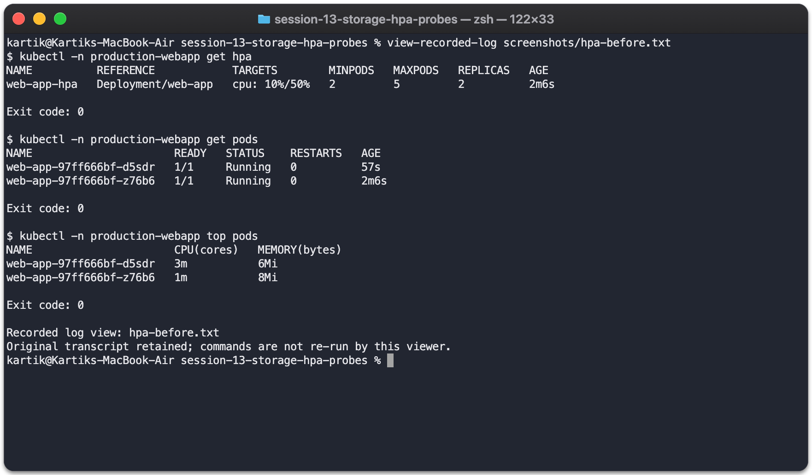
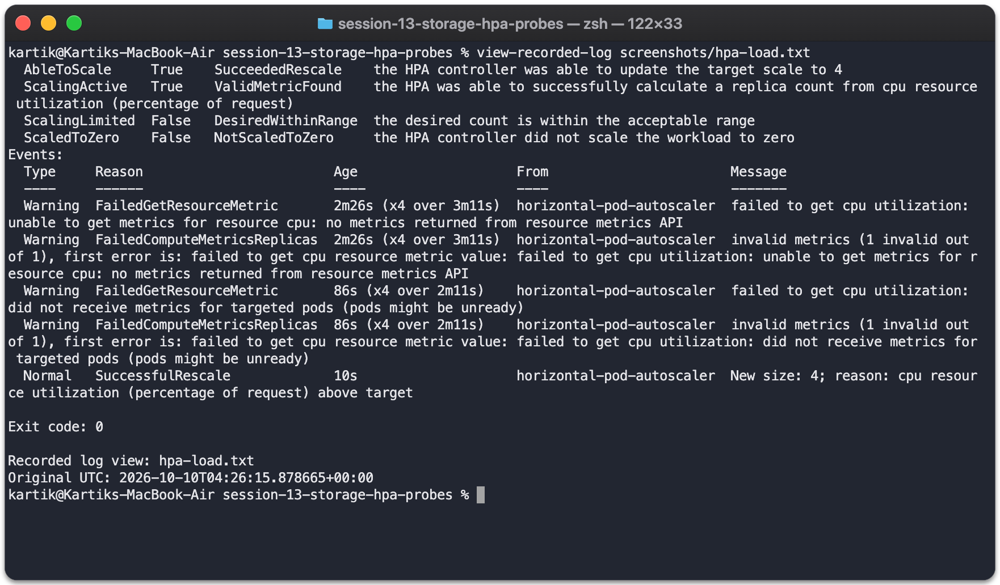
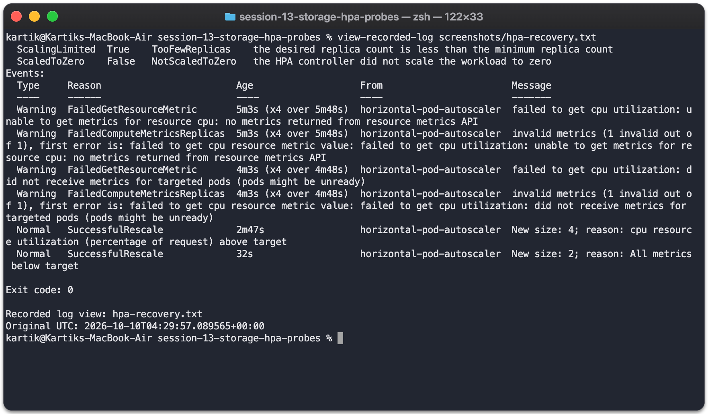
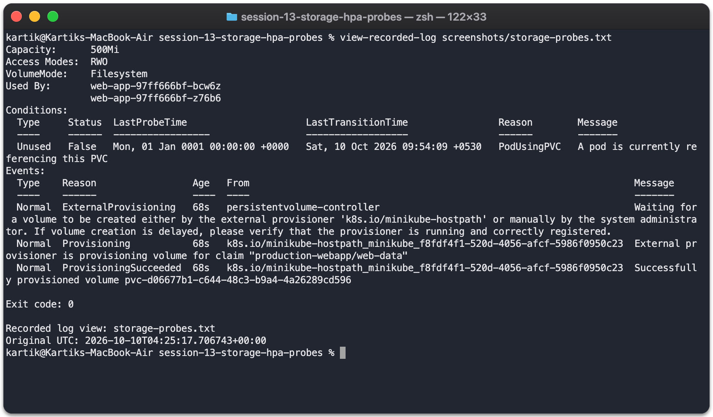

# Session 13 - Kubernetes Storage, HPA & Probes

Screenshot refresh (17 October 2026): terminal images now use live Mac zsh views of the recorded results. Original logs and dates are retained; test re-runs are marked separately. [Capture details](screenshots/mac/README.md).

Deployed the Nginx mini project in `production-webapp`. Added persistent storage, a Service, HPA and startup/readiness/liveness probes.

[Volume documentation and examples](01-kubernetes-volumes/README.md) · [Mini-project manifests](mini-project/) · [HPA YAML](mini-project/hpa.yml) · [Load generator](mini-project/load-generator.yaml)

## Deploy

```bash
minikube addons enable metrics-server
kubectl apply -f mini-project/namespace.yaml
kubectl apply -f mini-project/pvc.yaml
kubectl apply -f mini-project/deployment.yaml
kubectl apply -f mini-project/service.yaml
kubectl apply -f mini-project/hpa.yml
kubectl -n production-webapp rollout status deployment/web-app
kubectl -n production-webapp get pvc,pods,hpa
```

The 500Mi claim uses the `standard` StorageClass. All application Pods mount it at `/data`. The HPA targets 50% CPU utilization relative to the CPU request and allows 2–5 replicas.

Used a 10m CPU request and 100m limit per Nginx container for this local exercise. Set the scale-down window to 30 seconds so I could observe scaling back down. These values would need sizing again for production.

## HPA test

```bash
kubectl -n production-webapp get hpa
kubectl -n production-webapp get pods
kubectl -n production-webapp top pods
kubectl -n production-webapp describe hpa web-app-hpa
kubectl apply -f mini-project/load-generator.yaml
kubectl -n production-webapp get hpa -w
kubectl -n production-webapp top pods
kubectl -n production-webapp get pods
kubectl -n production-webapp delete pod load-generator
```

The generator runs eight HTTP workers with a 300m CPU limit. The captured output shows increased CPU utilization, an HPA SuccessfulRescale event and scaling from two to four application replicas. After stopping load, the deployment returned to two ready replicas.







[Before output](screenshots/hpa-before.txt) · [Load/scaling output](screenshots/hpa-load.txt) · [Recovery output](screenshots/hpa-recovery.txt)

## Mini-project verification

The PVC became Bound through dynamic provisioning. I wrote `Student: Kartik`, deleted that application Pod, waited for its new replacement and read the same file from `/data/student.txt`.


Startup probes allow initialization to finish before other checks run. Readiness determines whether a Pod receives Service traffic. Liveness restarts an unhealthy container. The deployment defines all three HTTP probes; ready Pods and successful Service requests were verified.



[Storage/probe output](screenshots/storage-probes.txt) · [Final Service and Pod checks](screenshots/final-verification.txt)

HPA initially showed `<unknown>` because metrics were not available yet. After Metrics Server collected samples, CPU usage appeared and scaling started.

## Cleanup

```bash
kubectl delete namespace production-webapp
```

Deleted the demo namespace and its dynamically provisioned PV after testing. [Cleanup output](screenshots/cleanup.txt).
