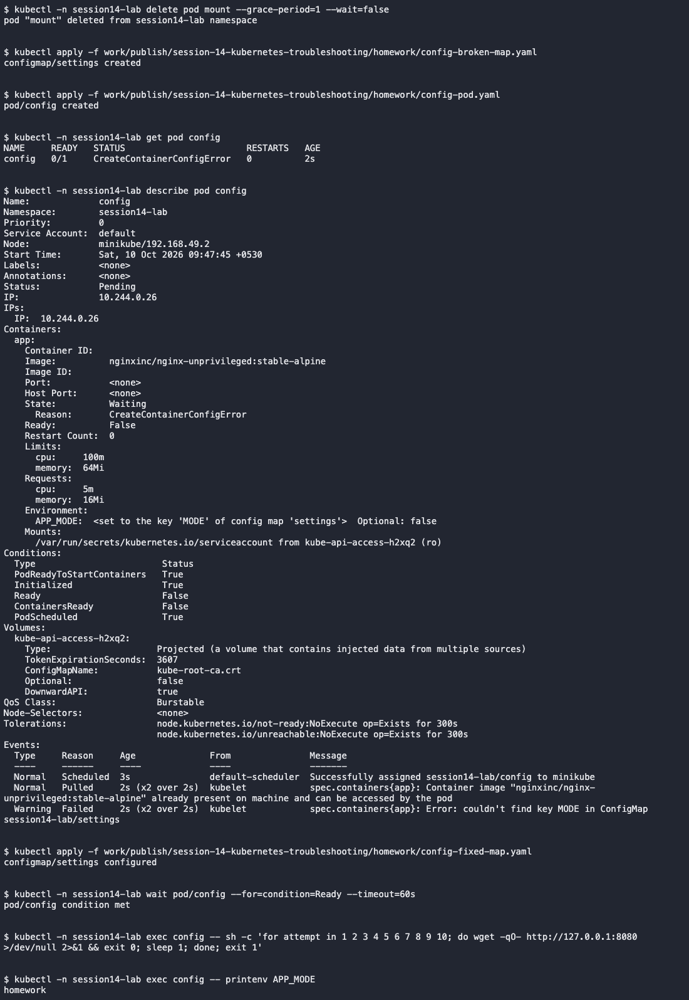

# Configuration error

Introduced this fault in `session14-lab` to practice finding and fixing it.

- Problem/root cause: An environment variable referenced a missing MODE key.
- Investigation: Pod status showed CreateContainerConfigError; describe identified the missing key.
- Fix: Added MODE=homework to the ConfigMap.
- Verification: The container started and printenv returned homework.

[Complete commands and output](../../screenshots/configuration.txt)
