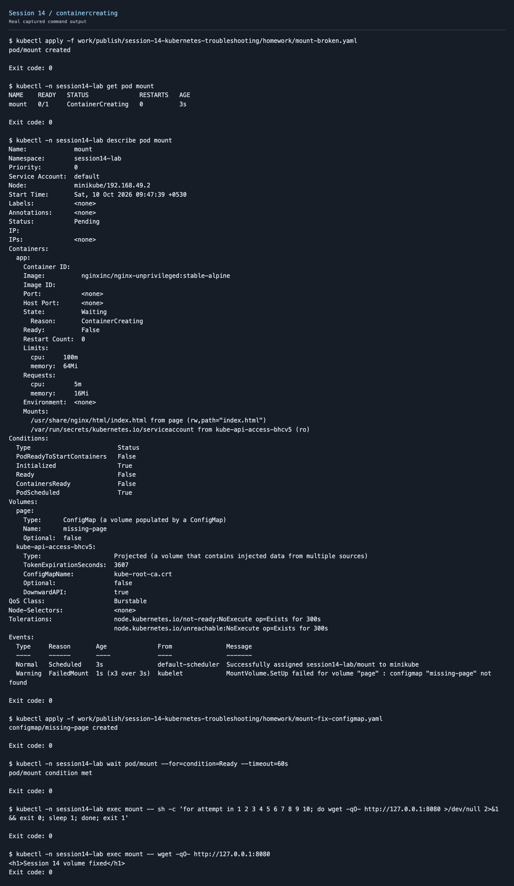

# ContainerCreating

This was an intentionally introduced classroom fault in `session14-lab`.

- Problem/root cause: A required ConfigMap volume did not exist.
- Investigation: Describe showed FailedMount for missing-page.
- Fix: Created the missing ConfigMap containing index.html.
- Verification: The page returned Session 14 volume fixed.

[Complete commands and output](../../screenshots/containercreating.txt)
