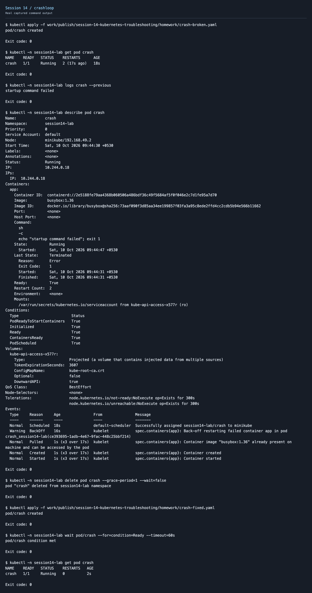

# CrashLoopBackOff

This was an intentionally introduced classroom fault in `session14-lab`.

- Problem/root cause: The startup command printed an error and exited with code 1.
- Investigation: Checked Pod status, previous logs and restart events.
- Fix: Recreated the Pod with the working Nginx image/command.
- Verification: The replacement Pod became Ready.

[Complete commands and output](../../screenshots/crashloop.txt)
