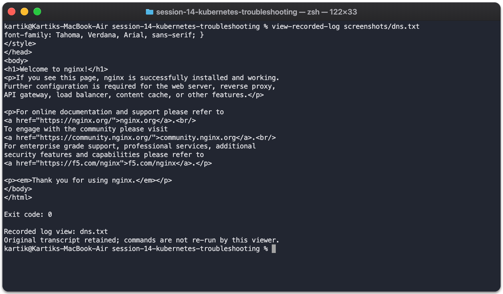

# DNS failure

Introduced this fault in `session14-lab` to practice finding and fixing it.

- Problem/root cause: The client used an unusable custom resolver with dnsPolicy=None.
- Investigation: Inspected /etc/resolv.conf and ran a failing nslookup.
- Fix: Recreated the Pod with the default ClusterFirst DNS policy.
- Verification: The Kubernetes service name resolved and HTTP to web succeeded.

[Complete commands and output](../../screenshots/dns.txt)
