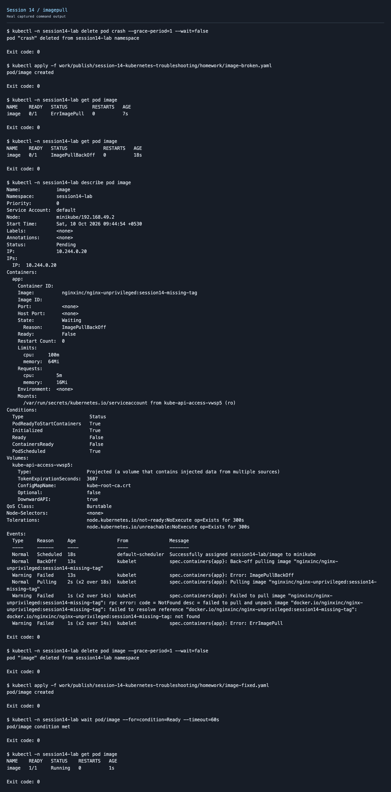

# ErrImagePull / ImagePullBackOff

This was an intentionally introduced classroom fault in `session14-lab`.

- Problem/root cause: The image tag did not exist in the registry.
- Investigation: Observed ErrImagePull followed by ImagePullBackOff; describe showed the missing-tag error.
- Fix: Used the existing valid image tag and recreated the Pod.
- Verification: The image was found and the Pod became Ready.

[Complete commands and output](../../screenshots/imagepull.txt)
