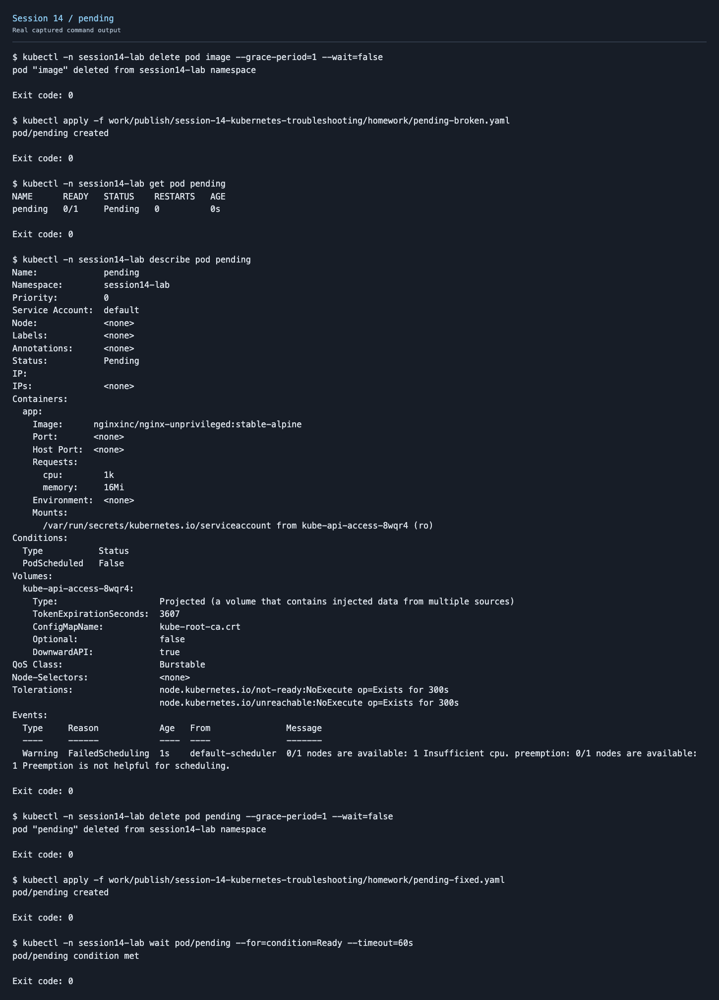

# Pending

This was an intentionally introduced classroom fault in `session14-lab`.

- Problem/root cause: A 1000-CPU request exceeded node capacity.
- Investigation: Describe showed FailedScheduling / insufficient CPU.
- Fix: Reduced requests to the small demo requirements.
- Verification: The replacement Pod was scheduled and became Ready.

[Complete commands and output](../../screenshots/pending.txt)
