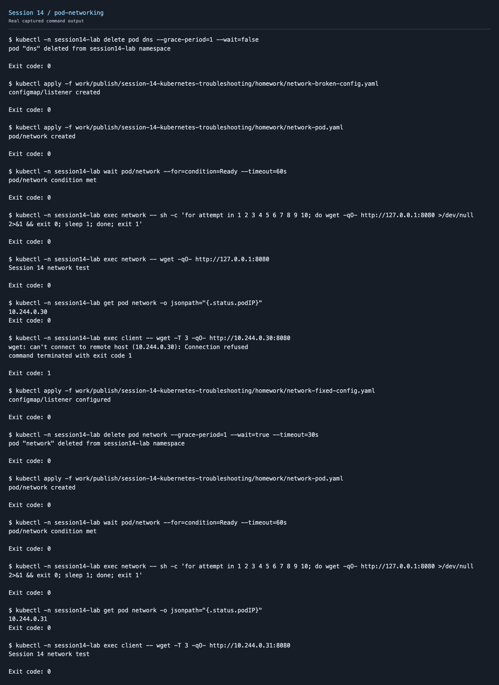

# Pod connectivity

This was an intentionally introduced classroom fault in `session14-lab`.

- Problem/root cause: Nginx listened only on 127.0.0.1, so another Pod could not reach its Pod IP.
- Investigation: Loopback HTTP succeeded; the client request to the Pod IP failed.
- Fix: Changed the listener to all interfaces and recreated the Pod.
- Verification: The client reached the server through its Pod IP.

[Complete commands and output](../../screenshots/pod-networking.txt)
