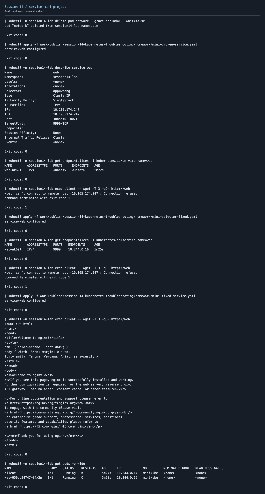

# Service connectivity / mini project

This was an intentionally introduced classroom fault in `session14-lab`.

- Problem/root cause: The Service had both a wrong selector and a wrong target port.
- Investigation: Describe and EndpointSlices showed no matching backend; after fixing the selector, HTTP still failed on port 9999.
- Fix: Matched app=web, then changed targetPort to 8080.
- Verification: The client received the Nginx page through the Service.

[Complete commands and output](../../screenshots/service-mini-project.txt)
