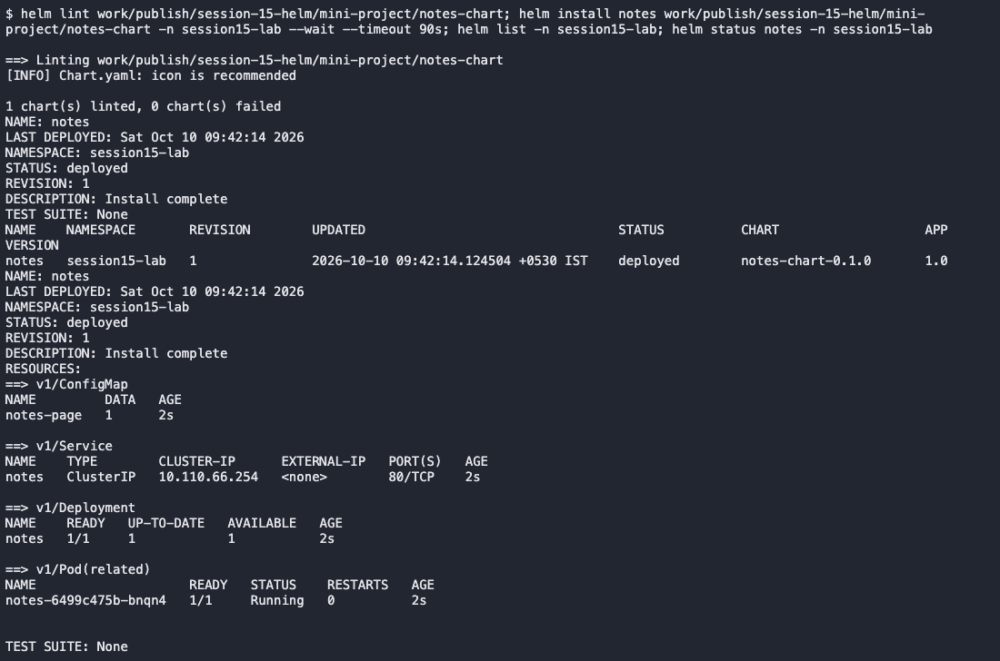
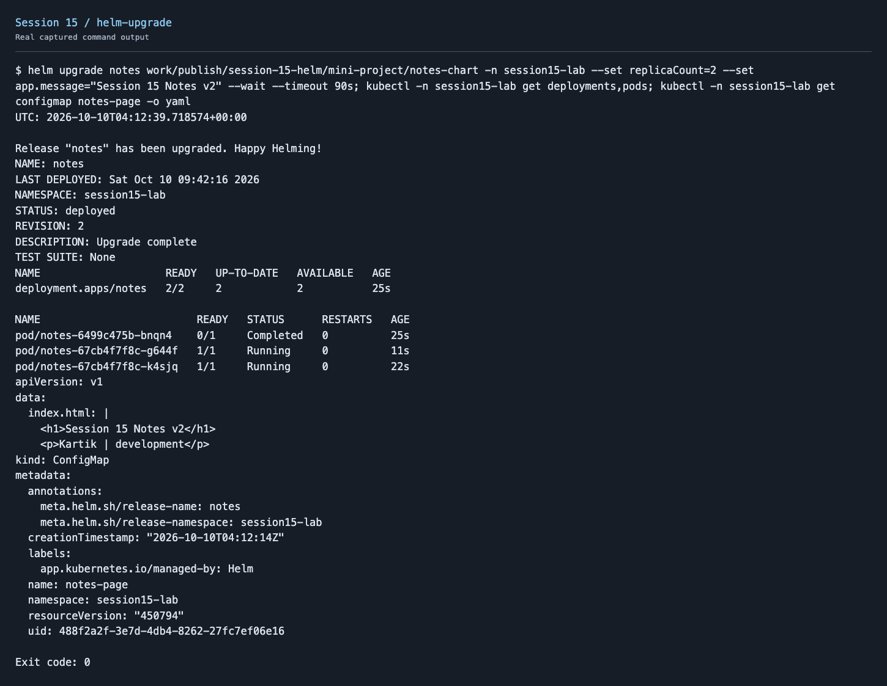
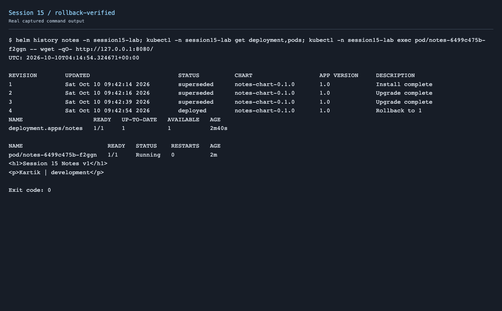

# Session 15 - Helm Homework

Packaged the Notes app as a Helm chart and deployed it in `session15-lab`. Used values to change the replicas and page content, then rolled back to the first revision.

[Chart](mini-project/notes-chart/) · [Development values](mini-project/notes-chart/values.yaml) · [Production values](mini-project/notes-chart/values-prod.yaml)

## Commands executed

| Commands | Purpose | Output |
| --- | --- | --- |
| helm create | Generate a starter chart | [Output](screenshots/helm-create.txt) |
| helm repo add/update/list; helm search repo | Register, refresh and search a chart repository | [Output](screenshots/helm-repo.txt) |
| helm lint; helm install; helm list; helm status | Validate and install the chart, then inspect its release | [Output](screenshots/helm-install.txt) |
| helm get values/manifest/all | Inspect deployed values and rendered resources | [Output](screenshots/helm-get.txt) |
| helm upgrade | Apply a new values revision | [First upgrade](screenshots/helm-upgrade.txt), [second upgrade](screenshots/helm-upgrade-again.txt) |
| helm history; helm rollback | Review revisions and restore revision 1 | [Output](screenshots/helm-rollback.txt), [verified page](screenshots/rollback-verified.txt) |
| helm uninstall | Remove the release | [Output](screenshots/helm-uninstall.txt) |

## Rollback workflow

```text
Install: revision 1, 1 replica, v1 development page
    ↓
Upgrade: revision 2, 2 replicas, v2 page
    ↓
Upgrade again: revision 3, 3 replicas, v3 production page
    ↓
Rollback to revision 1: new revision 4, 1 replica, v1 page restored
```








A rollback creates a new release revision. It restores earlier configuration while retaining release history.

## Mini project

The Notes chart renders its page from a ConfigMap. A checksum annotation rolls the Pods when that content changes. Both replicas and content were checked after upgrades; the rollback HTTP response confirmed v1 was restored.

One HTTP check initially used `localhost`, which resolved to IPv6 while this Nginx configuration listened on IPv4. The explicit `127.0.0.1` check succeeded. The failed attempt remains in the raw rollback transcript.

[Mini-project commands and manifests](mini-project/README.md) · [Create screenshot](screenshots/helm-create.png) · [Repository/search screenshot](screenshots/helm-repo.png) · [Get output](screenshots/helm-get.txt)

Uninstalled the demo release and removed its namespace after testing.

Lesson notes are below.

---

# Session 15: Helm

Managing many Kubernetes YAML files across multiple environments leads to copy-paste errors and configuration drift.

Helm solves this. It is the package manager for Kubernetes.

---

## Why Helm?

Without Helm, deploying to three environments means three separate sets of YAML files. Change one value and you update three files manually.

With Helm, you write one chart. You pass different values for each environment.

---

## Topics Covered

| Folder | Topic |
|--------|-------|
| `01-what-is-helm/` | What is Helm, installing Helm, first commands |
| `02-helm-charts/` | What is a Chart, creating and installing charts |
| `03-chart-structure/` | Chart directory layout, Chart.yaml, values.yaml, templates |
| `04-chart-yaml/` | Chart.yaml fields, version vs appVersion |
| `05-values-yaml/` | Default values, overriding with -f and --set |
| `06-templates/` | Go template syntax, variables, conditionals |
| `07-install-upgrade/` | helm install, helm upgrade, revision history |
| `08-rollback/` | helm rollback, --atomic flag, auto rollback |
| `09-deploying-application/` | Full application deployment: lint, install, upgrade, rollback |
| `mini-project/` | Deploy the Notes App from scratch using Helm |

---

## Core Concepts

**Chart:** A packaged collection of Kubernetes YAML templates with variables. Think of it as a recipe.

**Release:** A running instance of a chart deployed to a cluster. Think of it as the cooked meal.

**Values:** The variables you pass to customize the chart. Think of them as the ingredients.

---

## Key Commands

```bash
# Install Helm
curl https://raw.githubusercontent.com/helm/helm/main/scripts/get-helm-3 | bash

# Create a new chart
helm create my-chart

# Render templates locally (no cluster needed)
helm template my-release ./my-chart

# Check chart for errors
helm lint ./my-chart

# Install a chart
helm install my-release ./my-chart

# Install with custom values
helm install my-release ./my-chart -f values-prod.yaml

# List all releases
helm list

# Upgrade a release
helm upgrade my-release ./my-chart --set replicaCount=3

# View release history
helm history my-release

# Rollback to a previous revision
helm rollback my-release 1

# Remove a release
helm uninstall my-release
```

---

## Helm 2 vs Helm 3

```text
Helm 2: required Tiller (a server pod in the cluster)
        ran with cluster-admin privileges
        security risk

Helm 3: no Tiller
        client-only
        uses your kubeconfig permissions
        release state stored as Kubernetes Secrets
```

---

## Interview Preparation

**Beginner:**

Q: What is Helm?
A: Helm is a package manager for Kubernetes. It packages Kubernetes YAML files into parameterized charts that can be installed, upgraded, and rolled back with single commands.

Q: What is the difference between a Chart and a Release?
A: A Chart is the packaged template (the recipe). A Release is a running instance of that chart installed in a cluster (the cooked meal).

**Intermediate:**

Q: What is the difference between values.yaml and --set?
A: values.yaml holds the default configuration in version control. --set overrides individual values at runtime. In production pipelines, use separate values files (-f values-prod.yaml) so all configuration is auditable in Git.

Q: What does --atomic do?
A: During helm upgrade, --atomic auto-rolls back to the previous healthy revision if any pod fails readiness within the timeout period.

**Scenario-Based:**

Q: You run helm upgrade and it gets stuck in pending-upgrade state. What do you do?
A: Inspect helm secrets with kubectl get secrets -l owner=helm. Find the stuck pending revision secret and delete it. Then run helm rollback to the last healthy revision.

---

## Reference

* **Helm Documentation:** https://helm.sh/docs/
* **Helm Chart Template Guide:** https://helm.sh/docs/chart_template_guide/
* **Helm CLI Reference:** https://helm.sh/docs/helm/
