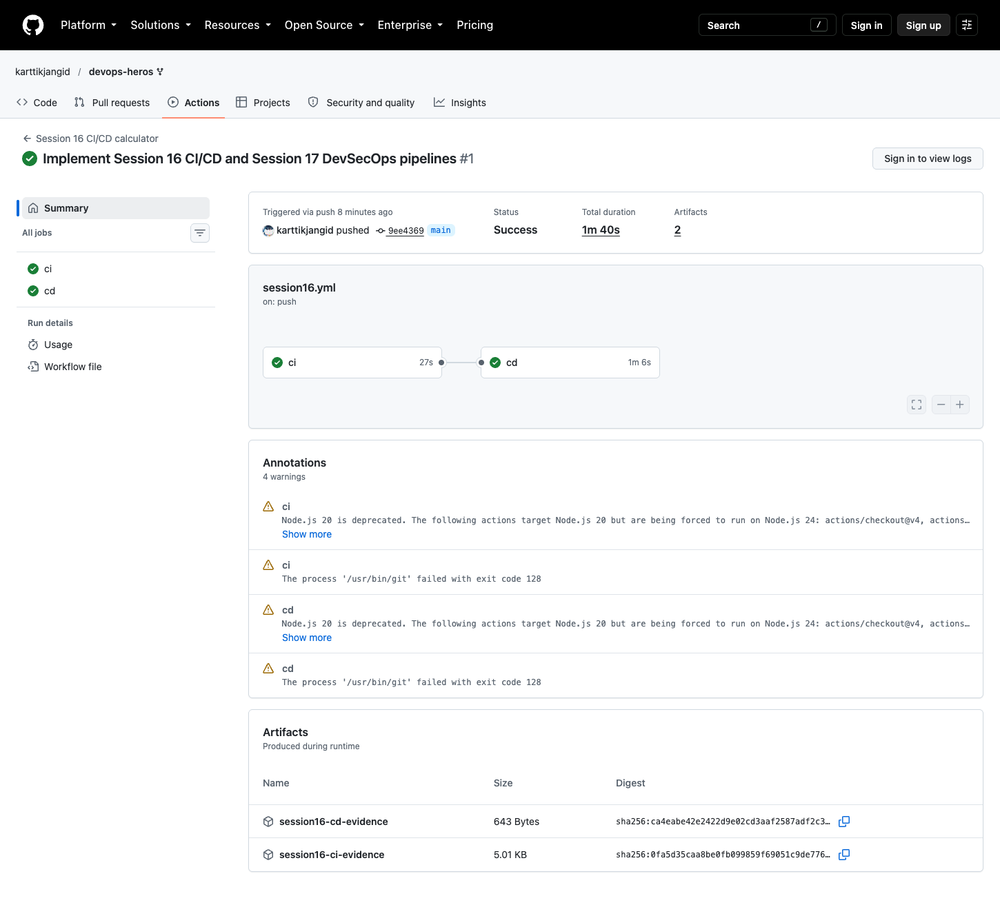
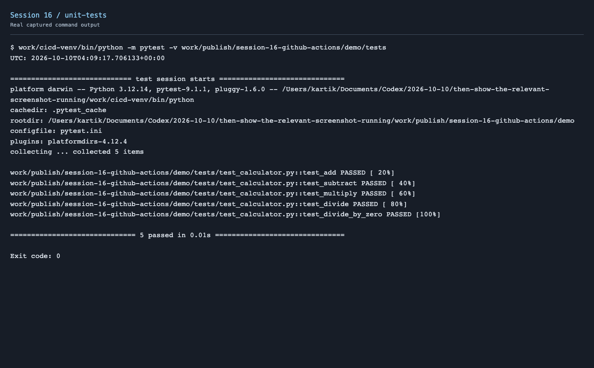
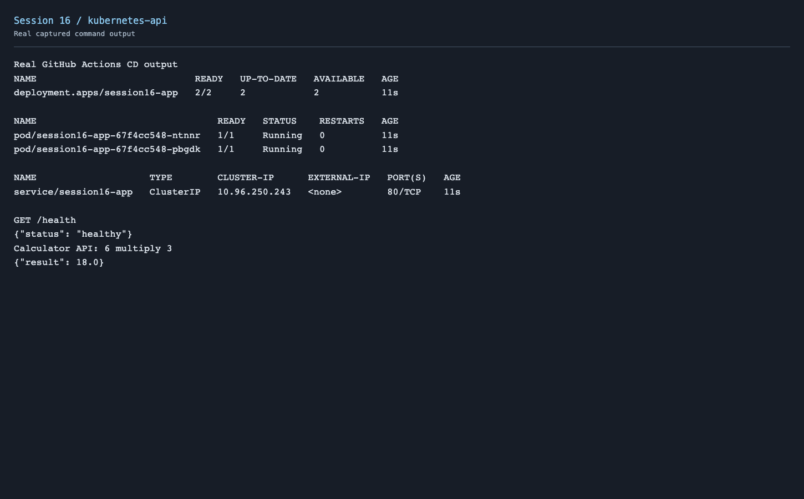

# Session 16 - CI/CD & GitHub Actions

I adapted the calculator from `10-final-cicd-pipeline` into a small HTTP application. Its five unit tests cover the four arithmetic operations and division by zero.

```text
Push to main → CI: build package → unit tests → Docker build → GHCR push
                  ↓ success
              CD: pull image → Kind Kubernetes → deploy → health/API tests
```

## Project

[Source](demo/app/) · [Tests](demo/tests/) · [Dockerfile](demo/Dockerfile) · [Kubernetes manifests](demo/k8s/) · [Active workflow](../.github/workflows/session16.yml)

The instructor's example is preserved in [10-final-cicd-pipeline](session-16-github-actions/10-final-cicd-pipeline/README.md).

## Concepts demonstrated

| Concept | Used in this project |
| --- | --- |
| CI vs CD | CI verifies and packages code; CD deploys the successful image |
| Workflow | Triggered by application changes on `main` or manual dispatch |
| Jobs | Separate `ci` and `cd`; `cd` requires successful `ci` |
| Steps | Checkout, setup, install, build, test, image build/push, deploy and verify |
| Runners | GitHub-hosted Ubuntu 24.04 machines |
| Secrets | Built-in `GITHUB_TOKEN` authenticates to GHCR; no credential is committed |
| Artifacts | Python wheel/source archive, test output and Kubernetes/API evidence |
| Build | Python package and non-root Docker image |
| Test | Five unit tests plus deployed health and calculator API tests |

The container registry is GHCR: `ghcr.io/karttikjangid/session16-calculator:<commit-sha>`. CD pulls the image from the registry, loads it into an isolated Kind cluster and deploys two replicas. The temporary cluster is removed when the job finishes; this is a classroom deployment rather than a persistent production environment.

## Run locally

```bash
cd session-16-github-actions/demo
python3.12 -m venv .venv
source .venv/bin/activate
pip install -r requirements-dev.txt
python -m build
pytest -v
python -m app.server
# In another terminal:
curl http://localhost:8000/health
curl "http://localhost:8000/api/calculate?a=6&b=3&operation=multiply"
```

```bash
docker build -t session16-calculator .
docker run --rm -p 8082:8000 session16-calculator
```

## Real pipeline evidence

[Successful CI/CD run](https://github.com/karttikjangid/devops-heros/actions/runs/38023093697)







[Pipeline output](screenshots/pipeline.txt) · [CI tests](screenshots/ci-unit-tests.txt) · [Deployment](screenshots/deployment.txt) · [Health response](screenshots/health.json) · [Calculator response](screenshots/api.json)

Both jobs succeeded. The deployed calculator returned 18 for 6 × 3. Downloadable build and deployment artifacts are attached to the run.
