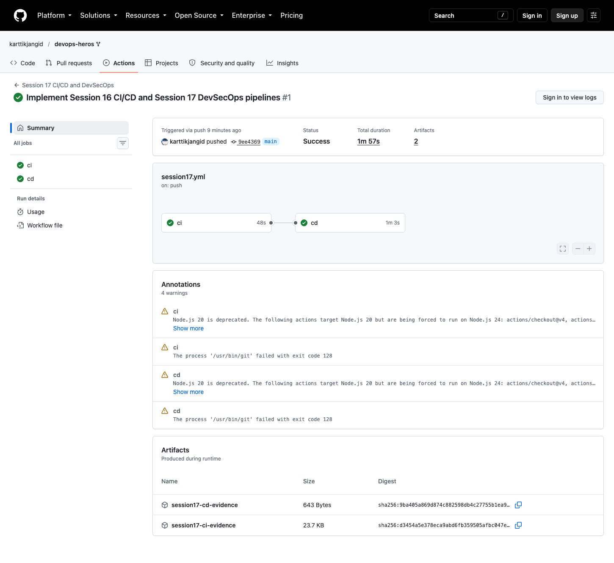
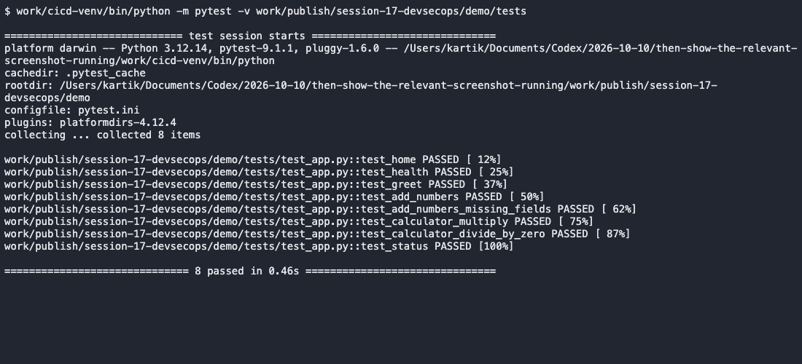
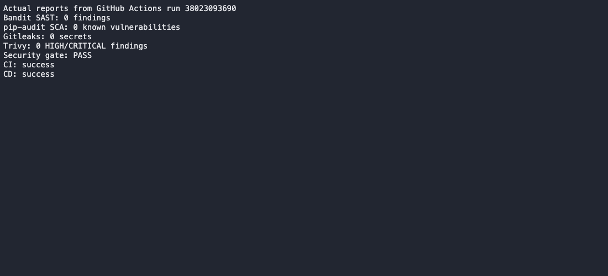
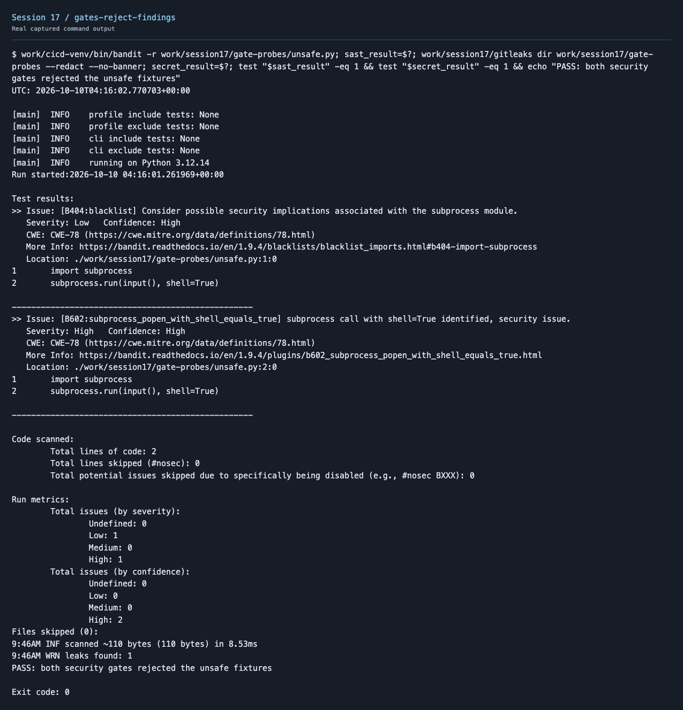
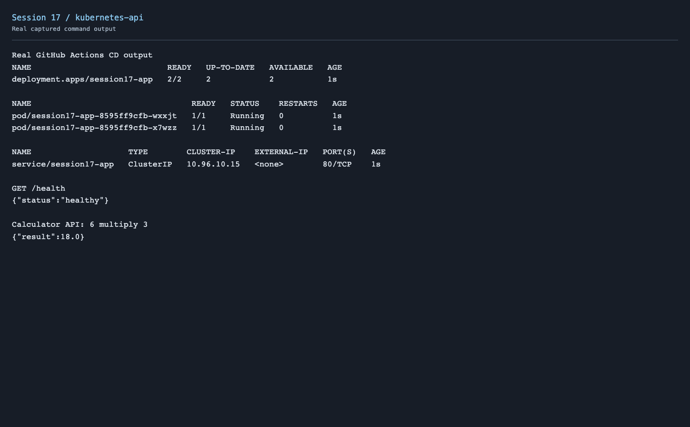
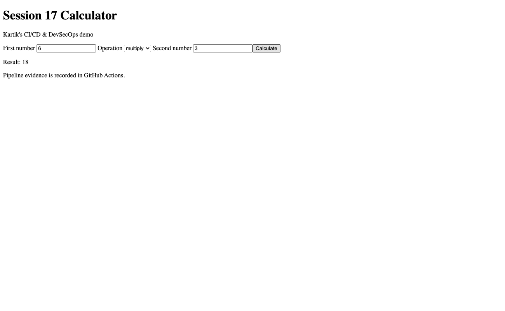

# Session 17 - Complete CI/CD & DevSecOps

Used the Flask starter to make a calculator. The form sends requests to the API, and GitHub Actions builds, tests, scans and deploys the application.

```text
Code → Application build → Unit tests → SAST → SCA → Secret scan
     → Docker build → Image scan → Security gate → GHCR push → Kubernetes
```

[Application](demo/app/) · [Tests](demo/tests/) · [Dockerfile](demo/Dockerfile) · [Kubernetes manifests](demo/k8s/) · [Active workflow](../.github/workflows/session17.yml)

## Security configuration

| Check | Tool and configuration | Gate |
| --- | --- | --- |
| SAST | Bandit scans `demo/app` | Any reported issue fails CI |
| SCA | pip-audit checks `requirements.txt` | Any known dependency vulnerability fails CI |
| Secret scan | Gitleaks, [default-rule configuration](demo/security/gitleaks.toml) | Any detected secret fails CI |
| Image scan | Trivy scans the built image | HIGH or CRITICAL findings fail CI |

Every scanner must exit successfully before image publishing. A failed CI job prevents the CD job. Used `always()` to save the reports even if a scan fails. Publishing and deployment still need the scans to pass.

Tested the gates with an unsafe shell command and a generated dummy token in temporary files. Bandit and Gitleaks both returned exit code 1. The token was redacted from the output.

The application has eight unit tests, a non-root image and Kubernetes readiness/liveness probes. Images are tagged with the commit SHA and published to `ghcr.io/karttikjangid/session17-devsecops`. GitHub's built-in token provides registry access. CD pulls the published image, deploys two replicas into an isolated Kind cluster and tests `/health` and the calculator API.

## Local commands

```bash
cd session-17-devsecops/demo
python3.12 -m venv .venv
source .venv/bin/activate
pip install -r requirements.txt -r requirements-dev.txt
python -m build
pytest -v
bandit -r app
pip-audit -r requirements.txt
gitleaks dir . --config security/gitleaks.toml --redact
docker build -t session17-devsecops .
trivy image --severity HIGH,CRITICAL --exit-code 1 session17-devsecops
docker run --rm -p 5001:5001 session17-devsecops
```

## Successful execution

[Successful CI/CD and DevSecOps run](https://github.com/karttikjangid/devops-heros/actions/runs/38023093690)













[Pipeline output](screenshots/pipeline.txt) · [CI tests](screenshots/ci-unit-tests.txt) · [Bandit report](screenshots/bandit-report.json) · [SCA report](screenshots/sca-report.json) · [Gitleaks report](screenshots/gitleaks-report.json) · [Trivy report](screenshots/container-report.json) · [Gate rejection output](screenshots/gates-reject-findings.txt) · [Kubernetes output](screenshots/deployment.txt)

CI and CD passed. SAST, SCA and secret scans reported zero findings; Trivy reported no HIGH/CRITICAL findings. Kubernetes had two ready replicas and the calculator returned 18 for 6 × 3. The Kind cluster is temporary and is removed when the job finishes.

## Problems and fixes

The starter contained a malformed Flask dependency line. I corrected it and pinned the runtime dependencies. The starter enabled debug mode and displayed simulated pipeline results; the deployed app now runs under Gunicorn and the README links to actual pipeline evidence.
