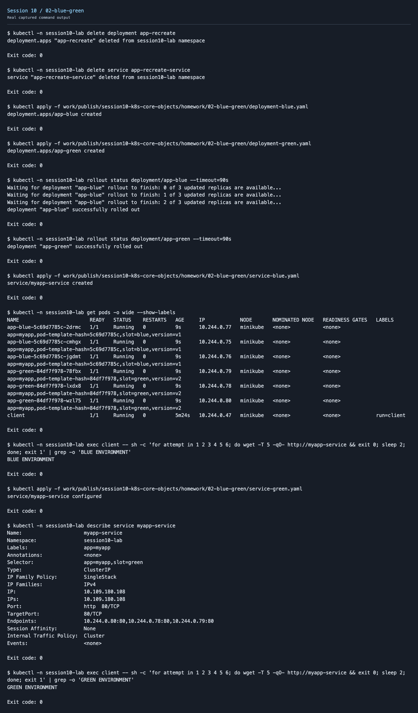
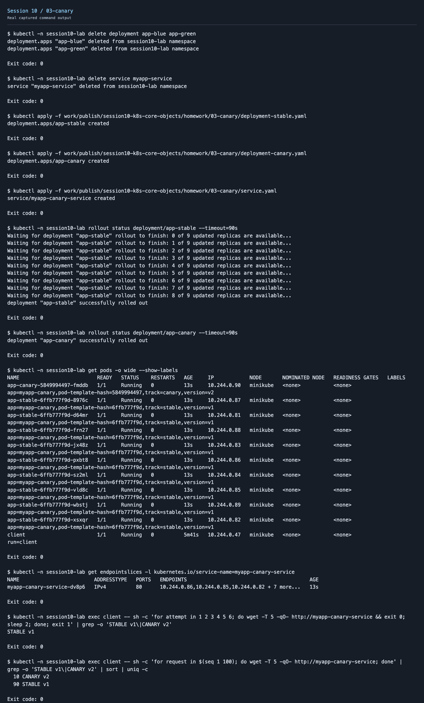
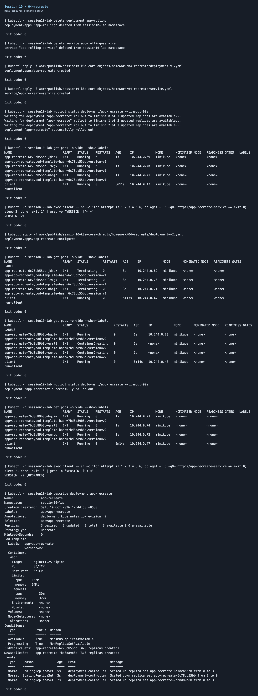

# Session 10 - Pods, ReplicaSets & Deployments

All four deployment strategies and all twelve lifecycle YAML examples were executed in the isolated local `session10-lab` namespace. Screenshots below come from saved command output.

## Deployment strategies

| Strategy | Verified behavior | Output |
| --- | --- | --- |
| Rolling update | Gradual v1→v2 Pod replacement with maxSurge=1 and maxUnavailable=0 | [Output](screenshots/01-rolling-update.txt) |
| Blue-green | Both versions ran; switching the Service selector changed the returned page from blue to green | [Output](screenshots/02-blue-green.txt) |
| Canary | Nine stable Pods and one canary shared a Service; requests reached both versions | [Output](screenshots/03-canary.txt) |
| Recreate | Old Pods terminated before replacement v2 Pods started | [Output](screenshots/04-recreate.txt) |








The 100-request canary sample returned 90 stable and 10 canary responses. Pod ratio approximates traffic distribution; a fixed percentage is not guaranteed for every sample. The runtime copies use ClusterIP Services for in-cluster testing and preserve the supplied Pod labels and update strategies.

## Pod lifecycle

[Per-YAML status, details, logs, screenshots and observations](pod-lifecycle/README.md)

[Executed namespaced YAML copies](homework/) · [Cleanup output](screenshots/cleanup.txt)

Official Pod phases are Pending, Running, Succeeded, Failed and Unknown. CrashLoopBackOff and ImagePullBackOff are container waiting reasons shown by kubectl; Terminating reflects deletion. Running does not necessarily mean Ready.

The original command notes follow as historical reference.

---

# Session 10 — Kubernetes Core Objects

> Earlier command notes; fresh screenshot evidence is linked above.

## Task 1: Cluster Health Verification & Baseline Environment Checks

```
$ kubectl version --output=yaml
clientVersion: {gitVersion: v1.37.0, platform: darwin/arm64, ...}
serverVersion:  {gitVersion: v1.37.0, platform: linux/arm64, ...}

$ kubectl cluster-info
Kubernetes control plane is running at https://127.0.0.1:36457
CoreDNS is running at https://127.0.0.1:36457/api/v1/namespaces/kube-system/services/kube-dns:dns/proxy

$ kubectl get nodes -o wide
NAME       STATUS   ROLES           AGE   VERSION   INTERNAL-IP    EXTERNAL-IP   OS-IMAGE                         KERNEL-VERSION                   CONTAINER-RUNTIME
minikube   Ready    control-plane   9d    v1.37.0   192.168.49.2   <none>        Debian GNU/Linux 12 (bookworm)   7.1.4-200.fc44.aarch64 (arm64)   containerd://2.3.4
```


## Task 2: Standard Pod Deployment, Extended Inspection & Teardown (`pod.yml`)

```
$ kubectl apply -f pod.yml
pod/nginx-pod created

$ kubectl get pods
NAME        READY   STATUS    RESTARTS   AGE
nginx-pod   1/1     Running   0          5s

$ kubectl get pods -o wide
NAME        READY   STATUS    RESTARTS   AGE   IP            NODE       NOMINATED NODE   READINESS GATES
nginx-pod   1/1     Running   0          5s    10.244.0.58   minikube   <none>           <none>

$ kubectl logs nginx-pod
...
2026/09/17 18:33:53 [notice] 1#1: nginx/1.31.6
2026/09/17 18:33:53 [notice] 1#1: start worker processes
2026/09/17 18:33:53 [notice] 1#1: start worker process 29
...

$ kubectl delete -f pod.yml
pod "nginx-pod" deleted from default namespace

$ kubectl get pods
No resources found in default namespace.
```


## Task 3: Error State Simulation — ErrImagePull & ImagePullBackOff

```
$ kubectl apply -f pod-lifecycle/06-imagepullbackoff.yaml
pod/lifecycle-image-error created

$ kubectl get pod lifecycle-image-error
NAME                    READY   STATUS             RESTARTS   AGE
lifecycle-image-error   0/1     ImagePullBackOff   0          16s

$ kubectl describe pod lifecycle-image-error | grep -A 10 Events:
Events:
  Type     Reason     Age               From               Message
  ----     ------     ----              ----               -------
  Normal   Scheduled  15s               default-scheduler  Successfully assigned default/lifecycle-image-error to minikube
  Warning  Failed     14s               kubelet            Failed to pull image "jakwehrgkaejw:kahsdfgkhj": ... pull access denied, repository does not exist or may require authorization
  Warning  Failed     14s               kubelet            Error: ErrImagePull
  Normal   BackOff    13s               kubelet            Back-off pulling image "jakwehrgkaejw:kahsdfgkhj"
  Warning  Failed     13s               kubelet            Error: ImagePullBackOff
  Normal   Pulling    2s (x2 over 15s)  kubelet            Pulling image "jakwehrgkaejw:kahsdfgkhj"

$ kubectl delete -f pod-lifecycle/06-imagepullbackoff.yaml
pod "lifecycle-image-error" deleted from default namespace
```


## Task 4: Capturing Transient Pod Lifecycle Stages (`hello.yml`)

```
$ kubectl apply -f hello.yml
pod/hello-pod created

$ for i in 1 2 3 4 5; do kubectl get pod hello-pod; sleep 2; done
NAME        READY   STATUS              RESTARTS   AGE
hello-pod   0/1     ContainerCreating   0          0s
hello-pod   0/1     ContainerCreating   0          2s
hello-pod   0/1     ContainerCreating   0          5s
hello-pod   0/1     ContainerCreating   0          7s
hello-pod   0/1     ContainerCreating   0          9s

$ kubectl logs hello-pod
Hello Kubernetes

$ kubectl delete -f hello.yml
pod "hello-pod" deleted from default namespace
```


## Task 5: Exhaustive Pod Lifecycle States & Probes Lab (`pod-lifecycle/`)

Runs through Pending, CrashLoopBackOff, Readiness, Liveness, Startup, Init container,
Multi-container, and Graceful termination — one pod at a time, each deleted before the next.

**Pending** (impossible resource request):
```
$ kubectl apply -f 02-pending.yaml
pod/lifecycle-pending created
$ kubectl get pod lifecycle-pending
NAME                READY   STATUS    RESTARTS   AGE
lifecycle-pending   0/1     Pending   0          5s
$ kubectl describe pod lifecycle-pending | grep -A 5 Events:
Events:
  Type     Reason            Age   From               Message
  Warning  FailedScheduling  5s    default-scheduler  0/1 nodes are available: 1 Insufficient memory...
```

**CrashLoopBackOff:**
```
$ kubectl apply -f 05-crashloopbackoff.yaml
$ timeout 20s kubectl get pod lifecycle-crashloop -w
NAME                  READY   STATUS              RESTARTS   AGE
lifecycle-crashloop   0/1     ContainerCreating   0          0s
lifecycle-crashloop   1/1     Running             0          13s
lifecycle-crashloop   0/1     Error               0          16s
lifecycle-crashloop   1/1     Running             1 (0s ago)   16s
lifecycle-crashloop   0/1     Error               1 (4s ago)   20s

$ kubectl logs lifecycle-crashloop --previous
unable to retrieve container logs for containerd://595f978531f5885fb73dc619e4d575bac3023370862680a822253e102a0a7044
```
**Readiness probe** (proves `Running != Ready`):
```
$ kubectl apply -f 07-readiness.yaml
NAME                  READY   STATUS              RESTARTS   AGE
lifecycle-readiness   0/1     ContainerCreating   0          0s
lifecycle-readiness   0/1     Running             0          3s   <- Running but NOT Ready
lifecycle-readiness   1/1     Running             0          6s   <- now Ready
```

**Liveness probe** (health file removed, container restarted):
```
$ kubectl apply -f 08-liveness.yaml
$ timeout 35s kubectl get pod lifecycle-liveness -w
lifecycle-liveness   1/1     Running   0          1s
lifecycle-liveness   1/1     Running   0          60s
lifecycle-liveness   1/1     Running   1 (2s ago)   63s
```
**Startup probe:**
```
$ kubectl apply -f 09-startup.yaml
NAME                READY   STATUS              RESTARTS   AGE
lifecycle-startup   0/1     ContainerCreating   0          0s
```

**Init container:**
```
$ kubectl describe pod lifecycle-init | grep -A 8 "Init Containers:"
Init Containers:
  setup:
    Image:  busybox:1.36
    Command:
      sh
```

**Multi-container pod:**
```
$ kubectl get pod lifecycle-multi-container
NAME                        READY   STATUS    RESTARTS   AGE
lifecycle-multi-container   2/2     Running   0          6s
$ kubectl logs lifecycle-multi-container -c sidecar
Sidecar is running
```

**Graceful termination:** applied and deleted; pod accepted the delete without issue.


## Task 6: Core Controller Objects Exploration (ReplicaSet & StatefulSet)

**ReplicaSet self-healing** — delete one pod, watch it get replaced immediately:
```
$ kubectl apply -f replicaset.yml
$ kubectl get rs nginx-rs
NAME       DESIRED   CURRENT   READY   AGE
nginx-rs   3         3         0       7s
$ kubectl get pods -l app=nginx
nginx-rs-9vwtq   0/1   ContainerCreating   0   6s
nginx-rs-hmslb   0/1   ContainerCreating   0   6s
nginx-rs-rp527   0/1   ContainerCreating   0   6s

$ kubectl delete pod nginx-rs-9vwtq
pod "nginx-rs-9vwtq" deleted

$ kubectl get pods -l app=nginx
nginx-rs-6jfxk   1/1   Running   0   35s   <- brand-new replacement pod
nginx-rs-hmslb   1/1   Running   0   41s
nginx-rs-rp527   1/1   Running   0   41s
```

**StatefulSet** — real failure, reported as-is:
```
$ kubectl apply -f k8s-core-objects/statefulset.yml
statefulset.apps/mysql created
$ kubectl get statefulset mysql
NAME    READY   AGE
mysql   0/3     8s
$ kubectl get pods -l app=mysql
NAME      READY   STATUS         RESTARTS   AGE
mysql-0   0/1     ErrImagePull   0          8s
```
## Task 7: DaemonSet Architecture & Host Agent Deployment

```
$ kubectl apply -f k8s-core-objects/deamonset.yml
daemonset.apps/node-exporter created
$ kubectl get ds
NAME            DESIRED   CURRENT   READY   UP-TO-DATE   AVAILABLE   NODE SELECTOR   AGE
node-exporter   1         1         1       1            1           <none>          2s
$ kubectl get pods -l app=node-exporter -o wide
NAME                  READY   STATUS    RESTARTS   AGE   IP            NODE       NOMINATED NODE   READINESS GATES
node-exporter-cvr4s   1/1     Running   0          2s    10.244.0.74   minikube   <none>           <none>
```
## Task 8: Deployment Upgrades, Rolling Updates & Instant Rollbacks

```
$ kubectl apply -f deployment-v1.yaml
deployment.apps/app-rolling created
$ kubectl apply -f service.yaml
service/app-rolling-service created
$ kubectl rollout status deployment/app-rolling
deployment "app-rolling" successfully rolled out
$ kubectl get pods -l app=app-rolling --show-labels
(4 pods, all version=v1)

$ kubectl apply -f deployment-v2.yaml
deployment.apps/app-rolling configured
$ kubectl rollout status deployment/app-rolling
deployment "app-rolling" successfully rolled out
$ kubectl get pods -l app=app-rolling --show-labels
app-rolling-56bff6d88c-8f8vs   1/1   Running   0   23s   version=v2
app-rolling-56bff6d88c-pjhkf   1/1   Running   0   53s   version=v2
app-rolling-56bff6d88c-rc4j6   1/1   Running   0   29s   version=v2
app-rolling-56bff6d88c-wkvsm   1/1   Running   0   17s   version=v2

$ kubectl rollout history deployment/app-rolling
REVISION  CHANGE-CAUSE
1         <none>
2         <none>

$ kubectl rollout undo deployment/app-rolling
Warning: resource deployments/app-rolling was previously managed with 'kubectl apply'. Rolling back will not update the kubectl.kubernetes.io/last-applied-configuration annotation...
deployment.apps/app-rolling rolled back
$ kubectl rollout status deployment/app-rolling
deployment "app-rolling" successfully rolled out
$ kubectl get pods -l app=app-rolling --show-labels
(all 4 pods back to version=v1)

$ kubectl delete -f service.yaml -f deployment-v1.yaml
service "app-rolling-service" deleted
deployment.apps "app-rolling" deleted
```
## Task 9: Real-World Troubleshooting Scenarios Lab

**```
$ kubectl apply -f broken-image.yaml
deployment.apps/yatri-backend created
$ kubectl rollout status deployment/yatri-backend --timeout=30s || true
Waiting for deployment "yatri-backend" rollout to finish: 0 out of 3 new replicas have been updated...
error: timed out waiting for the condition

$ kubectl get pods -l app=yatri-backend
yatri-backend-77dbb657cd-6xpwq   0/1   ErrImagePull       0   30s
yatri-backend-77dbb657cd-hlhdm   0/1   ImagePullBackOff   0   30s
yatri-backend-77dbb657cd-pb7r7   0/1   ErrImagePull       0   30s

$ kubectl rollout undo deployment/yatri-backend
error: no rollout history found for deployment "yatri-backend"

$ kubectl delete -f broken-image.yaml
deployment.apps "yatri-backend" deleted
```

**```
$ kubectl apply -f selector-mismatch.yaml
The Deployment "selector-error-demo" is invalid: spec.template.metadata.labels: Invalid value: {"app":"wrong-app-name"}: `selector` does not match template `labels`
```
```
$ kubectl apply -f selector-mismatch.yaml
deployment.apps/selector-error-demo created
$ kubectl get pods -l app=correct-app-name
selector-error-demo-54996d6787-wbgfz   0/1   ContainerCreating   0   5s
$ kubectl delete -f selector-mismatch.yaml
deployment.apps "selector-error-demo" deleted
```


## Task 10: Theoretical & Architectural Conceptual Writeup

1. **The 4 ports.** `containerPort` is just documentation on the container spec — it doesn't
   open anything by itself. `targetPort` is the port on the Pod that a Service actually forwards
   traffic to. `port` is the Service's own internal cluster-facing port (what other pods talk
   to). `nodePort` (30000–32767) is the port opened on *every* node's external IP for external
   access.
2. **Labels vs Selectors.** Labels are just key/value metadata attached to an object (a Pod, a
   Deployment, whatever). Selectors are how a controller or Service *queries* for objects with
   matching labels — the label is the tag, the selector is the search filter.
3. **The 4 deployment strategies.** RollingUpdate replaces pods gradually, zero downtime.
   Recreate kills everything then starts everything, brief downtime, needed for things like
   RWO volumes or breaking schema migrations. Blue-Green runs two full environments side by side
   and flips a Service selector instantly (200% resource cost, instant rollback). Canary runs a
   small number of new-version pods alongside the stable ones and shifts traffic gradually by
   changing the pod-count ratio.
4. **`maxSurge` / `maxUnavailable` math.** For `replicas: 4, maxSurge: 1, maxUnavailable: 0`:
   max pods during rollout = 4 + 1 = 5, minimum available = 4 - 0 = 4. Full serving capacity is
   maintained throughout the whole rollout — this is exactly what was observed in Task 8's curl
   loop (no failed requests during the v1→v2 switch).
5. **Requests vs Limits.** A `request` is what the scheduler guarantees is reserved for the pod
   — it's used to decide which node the pod can even be placed on. A `limit` is the hard ceiling
   enforced by the cgroup — CPU usage above the limit gets throttled, memory usage above the
   limit gets the pod OOM-killed. And the units are genuinely different scales: 1 GB = 10^9
   bytes (decimal, what disk manufacturers use), 1 GiB = 2^30 = 1,073,741,824 bytes (binary).
   Kubernetes' `Mi`/`Gi` suffixes are always the binary ones.


## Task 11: Blue-Green Deployment Execution & Instant Selector Cutover

```
$ kubectl apply -f deployment-blue.yaml
$ kubectl apply -f deployment-green.yaml
$ kubectl get pods -l app=myapp --show-labels
(3 app-blue pods, slot=blue,version=v1 — 3 app-green pods, slot=green,version=v2)

$ kubectl apply -f service-blue.yaml
service/myapp-service created
$ kubectl describe svc myapp-service | grep Selector
Selector:                 app=myapp,slot=blue
$ kubectl get endpoints myapp-service
myapp-service   10.244.0.82:80,10.244.0.83:80,10.244.0.84:80   0s

$ curl -s http://$(minikube ip):30020 | grep -i "ENVIRONMENT" || curl -s http://localhost:30020 | grep -i "ENVIRONMENT"
(both attempts returned nothing — neither route works under the podman driver on this Mac)
```
```
$ curl -s $TUNNEL_URL | grep -i ENVIRONMENT
<p>BLUE ENVIRONMENT</p>
```

**The switch:**
```
$ kubectl apply -f service-green.yaml
service/myapp-service configured
$ kubectl describe svc myapp-service | grep Selector
Selector:                 app=myapp,slot=green
$ kubectl get endpoints myapp-service
myapp-service   10.244.0.79:80,10.244.0.80:80,10.244.0.81:80   39s   <- 3 different IPs now
$ curl -s $TUNNEL_URL | grep -i ENVIRONMENT
<p>GREEN ENVIRONMENT</p>
```

**Rollback:**
```
$ kubectl apply -f service-blue.yaml
service/myapp-service configured
$ curl -s $TUNNEL_URL | grep -i ENVIRONMENT
<p>BLUE ENVIRONMENT</p>

$ kubectl delete -f service-blue.yaml -f deployment-blue.yaml -f deployment-green.yaml
```


## Task 12: Canary Deployment Execution & Pod-Ratio Traffic Splitting

```
$ kubectl apply -f deployment-stable.yaml
$ kubectl apply -f service.yaml
$ kubectl rollout status deployment/app-stable
deployment "app-stable" successfully rolled out   (9/9 pods)

$ kubectl apply -f deployment-canary.yaml
$ kubectl rollout status deployment/app-canary
deployment "app-canary" successfully rolled out   (1/1 pods)
$ kubectl get pods -l app=myapp-canary --show-labels
(9 app-stable pods track=stable,version=v1 + 1 app-canary pod track=canary,version=v2)
$ kubectl get endpoints myapp-canary-service
myapp-canary-service   10.244.0.85:80,10.244.0.86:80,10.244.0.87:80 + 7 more...
```
20-request traffic split test (via the same NodePort tunnel workaround as Task 11):
```
$ for i in $(seq 1 20); do curl -s $TUNNEL_URL; done | grep -o "STABLE v1\|CANARY v2"
STABLE v1 x16, CANARY v2 x2, STABLE v1 x2   <- 2/20 = 10%, matches the 9:1 pod ratio
```

Scaled to 30% canary:
```
$ kubectl scale deployment app-canary --replicas=3
$ kubectl scale deployment app-stable --replicas=7
$ kubectl get endpoints myapp-canary-service
myapp-canary-service   10.244.0.85:80,10.244.0.86:80,10.244.0.88:80 + 7 more...   (10 total)
```

Rolled back to 100% stable:
```
$ kubectl scale deployment app-canary --replicas=0
$ kubectl scale deployment app-stable --replicas=9
$ for i in $(seq 1 5); do curl -s $TUNNEL_URL; done | grep -o "STABLE v1\|CANARY v2"
STABLE v1
STABLE v1
STABLE v1
STABLE v1
STABLE v1

$ kubectl delete -f service.yaml -f deployment-canary.yaml -f deployment-stable.yaml
```


## Task 13: Recreate Deployment Execution & Downtime Outage Demonstration

```
$ kubectl apply -f deployment-v1.yaml
$ kubectl apply -f service.yaml
$ kubectl rollout status deployment/app-recreate
deployment "app-recreate" successfully rolled out
$ kubectl get pods -l app=app-recreate
(3 pods Running)
```

```
$ ( for i in $(seq 1 40); do curl -s --connect-timeout 1 --max-time 1 $TUNNEL_URL | grep -o 'VERSION: [^<]*' || echo "[OUTAGE] Connection failed"; sleep 0.5; done ) &
$ kubectl rollout undo deployment/app-recreate
deployment.apps/app-recreate rolled back

VERSION: v2 (UPGRADED)
VERSION: v2 (UPGRADED)
VERSION: v2 (UPGRADED)
[OUTAGE] Connection failed
VERSION: v1
VERSION: v1
... (v1 continues)
```
```
$ kubectl apply -f deployment-v2.yaml   (initial v1->v2 trigger, watched with a bounded kubectl get pods -w)
app-recreate-6c78cb55bb-7qls6   1/1   Terminating   0   39s
app-recreate-6c78cb55bb-7qls6   0/1   Completed     0   40s   <- all 3 v1 pods hit Completed
app-recreate-6c78cb55bb-8fd5t   0/1   Completed     0   41s
app-recreate-6c78cb55bb-pfzch   0/1   Completed     0   41s
app-recreate-7bd8d89b8b-8wqph   0/1   Pending             0   0s   <- only then do v2 pods appear
app-recreate-7bd8d89b8b-8wqph   1/1   Running             0   0s
```

```
$ kubectl rollout status deployment/app-recreate
deployment "app-recreate" successfully rolled out
$ kubectl rollout history deployment/app-recreate
REVISION  CHANGE-CAUSE
2         <none>
3         <none>

$ kubectl delete -f service.yaml -f deployment-v2.yaml
service "app-recreate-service" deleted
deployment.apps "app-recreate" deleted
```
