# Completed lifecycle homework

Each YAML was applied and inspected with get, describe and logs. Expected failures are part of the exercise.

## 01-running

Nginx reached Running and Ready.

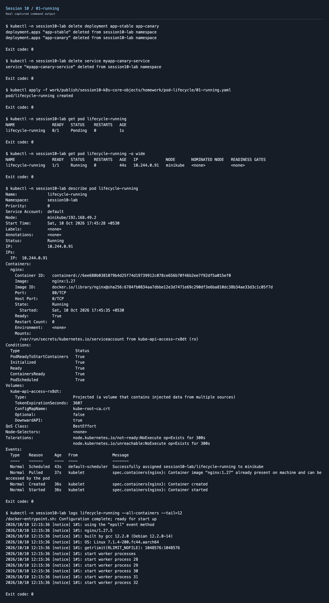

[Full commands and output](../screenshots/01-running.txt) · [Executed YAML](../homework/pod-lifecycle/01-running.yaml)

## 02-pending

The 9Gi memory request could not be scheduled on the small node.

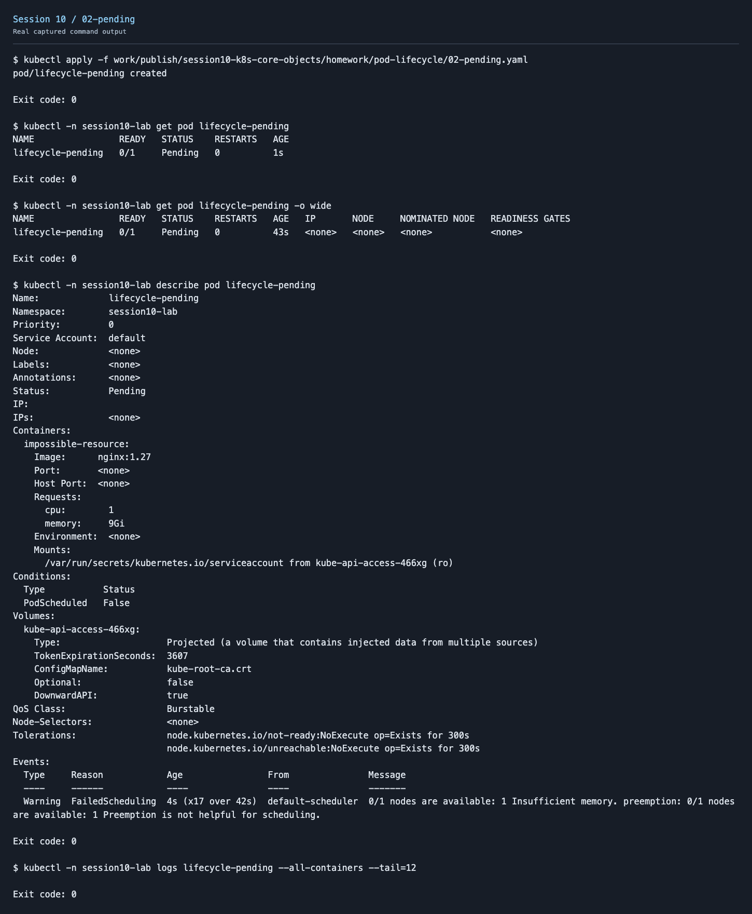

[Full commands and output](../screenshots/02-pending.txt) · [Executed YAML](../homework/pod-lifecycle/02-pending.yaml)

## 03-succeeded

The task exited 0; kubectl showed Completed and the Pod phase was Succeeded.

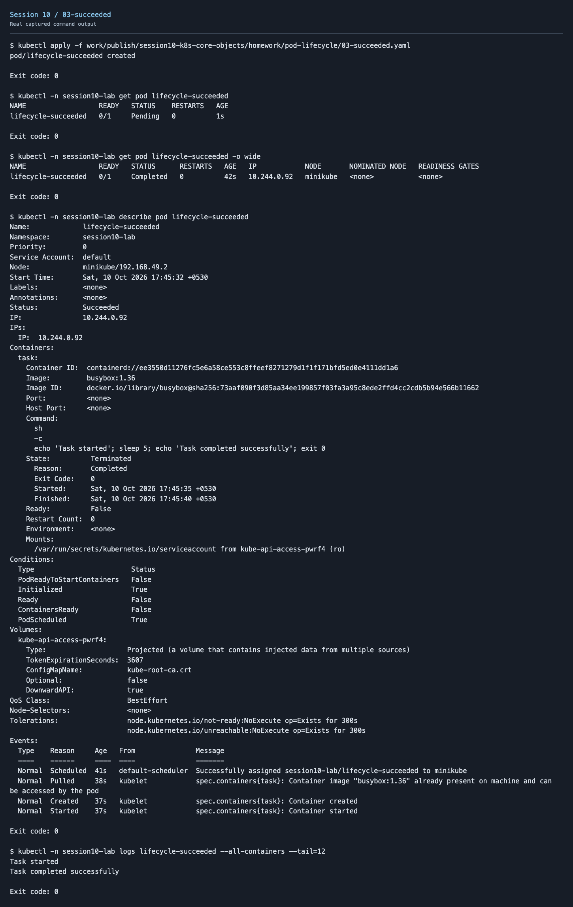

[Full commands and output](../screenshots/03-succeeded.txt) · [Executed YAML](../homework/pod-lifecycle/03-succeeded.yaml)

## 04-failed

The task exited 1; kubectl showed Error and the Pod phase was Failed.

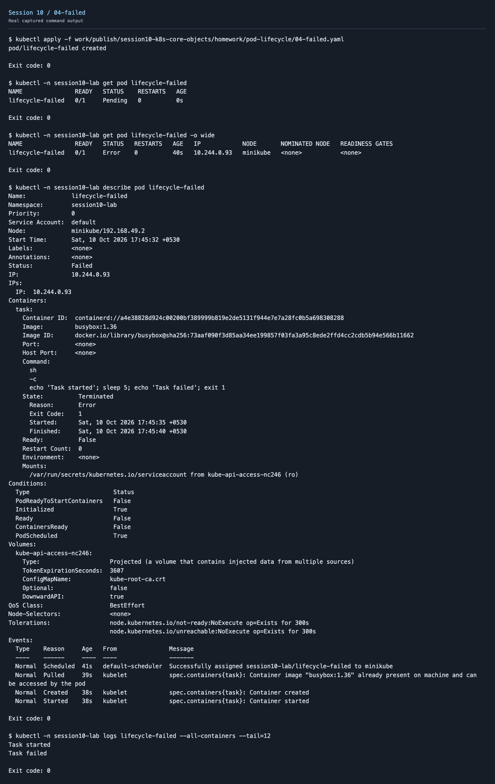

[Full commands and output](../screenshots/04-failed.txt) · [Executed YAML](../homework/pod-lifecycle/04-failed.yaml)

## 05-crashloopbackoff

The application repeatedly exited 1 and Kubernetes restarted it.

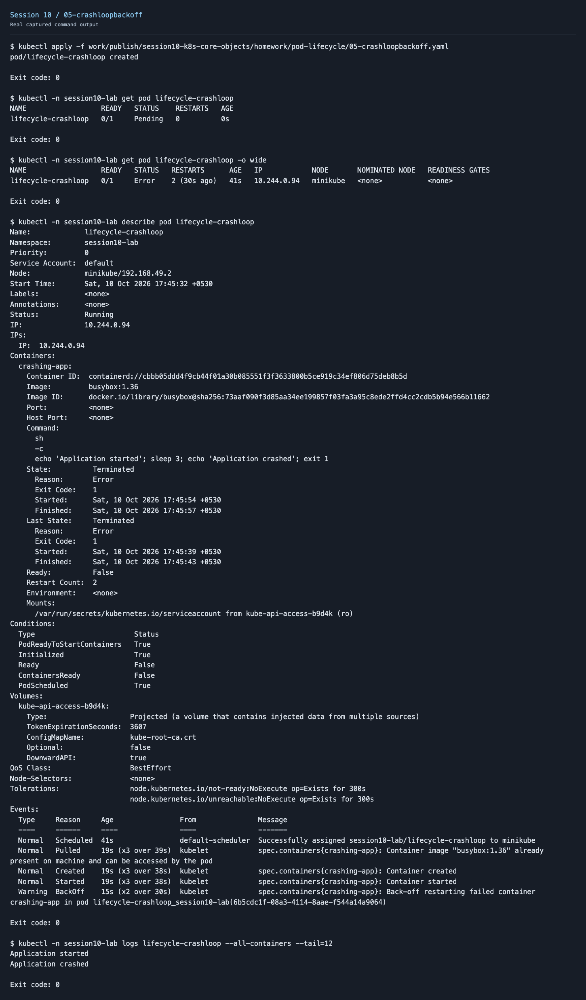

[Full commands and output](../screenshots/05-crashloopbackoff.txt) · [Executed YAML](../homework/pod-lifecycle/05-crashloopbackoff.yaml)

## 06-imagepullbackoff

The unavailable image produced pull errors/backoff events; no container started.

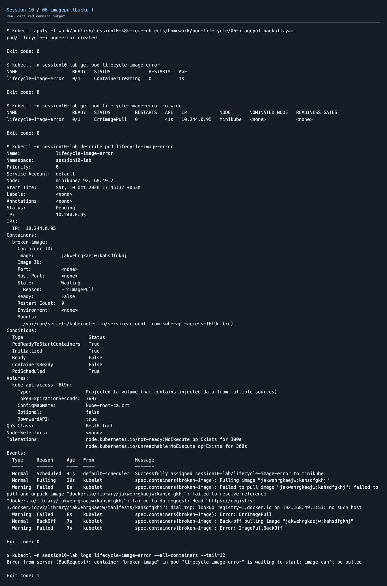

[Full commands and output](../screenshots/06-imagepullbackoff.txt) · [Executed YAML](../homework/pod-lifecycle/06-imagepullbackoff.yaml)

## 07-readiness

Readiness checked HTTP before the Pod became eligible for traffic.

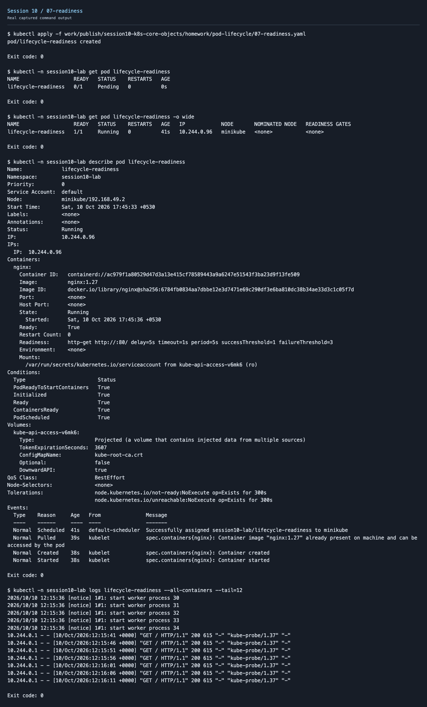

[Full commands and output](../screenshots/07-readiness.txt) · [Executed YAML](../homework/pod-lifecycle/07-readiness.yaml)

## 08-liveness

Removing the health file caused failed probes and an actual container restart.

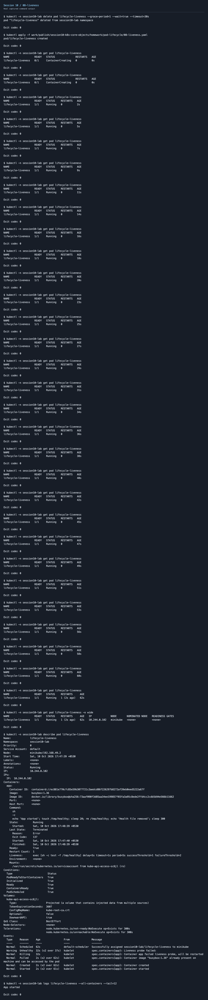

[Full commands and output](../screenshots/08-liveness.txt) · [Executed YAML](../homework/pod-lifecycle/08-liveness.yaml)

## 09-startup

The startup probe allowed the 30-second initialization before the container became Ready.

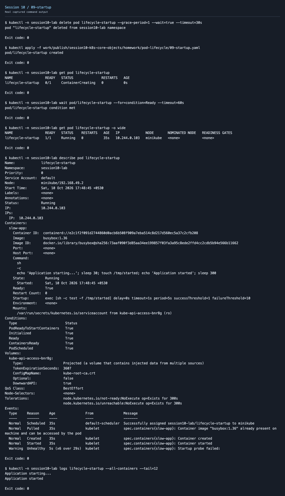

[Full commands and output](../screenshots/09-startup.txt) · [Executed YAML](../homework/pod-lifecycle/09-startup.yaml)

## 10-init-container

The setup container completed before the main Nginx container ran.

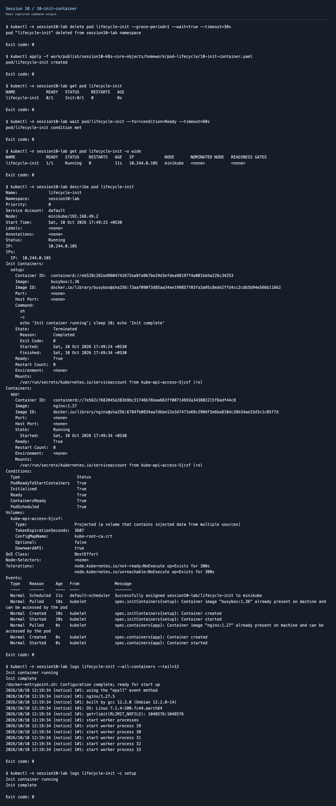

[Full commands and output](../screenshots/10-init-container.txt) · [Executed YAML](../homework/pod-lifecycle/10-init-container.yaml)

## 11-multi-container

Both containers ran in one Pod; separate container logs were inspected.

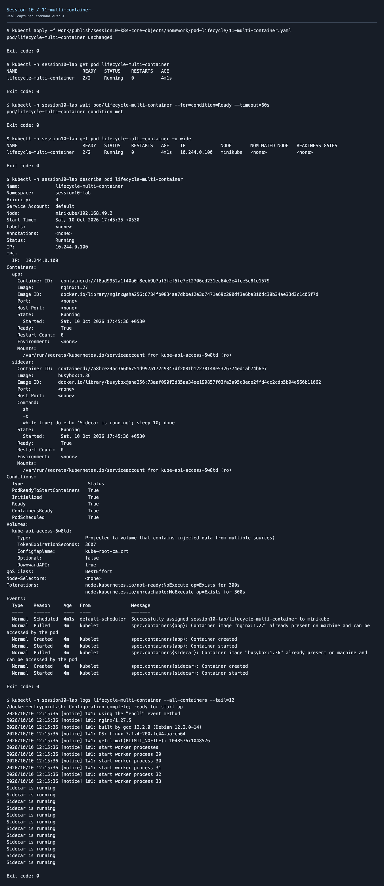

[Full commands and output](../screenshots/11-multi-container.txt) · [Executed YAML](../homework/pod-lifecycle/11-multi-container.yaml)

## 12-termination

The SIGTERM trap printed cleanup messages before the Pod was deleted.

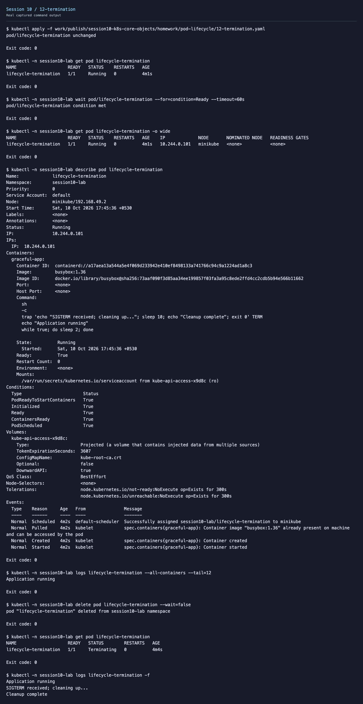

[Full commands and output](../screenshots/12-termination.txt) · [Executed YAML](../homework/pod-lifecycle/12-termination.yaml)

---

# Kubernetes Pod Lifecycle Lab

This lab demonstrates the major Pod lifecycle situations using small, independent YAML files.

## Recommended

1. Running
2. Pending
3. Init container
4. Readiness
5. Liveness
6. Startup probe
7. Succeeded
8. Failed
9. CrashLoopBackOff
10. ImagePullBackOff
11. Multi-container Pod
12. Graceful termination

## Start the live watch

Run this in Terminal 1:

```bash
kubectl get pods -w
```

Then apply examples from another terminal.

## Basic commands

Create:
```bash
kubectl apply -f 01-running.yaml
```

Watch:
```bash
kubectl get pods -w
```

Detailed lifecycle:
```bash
kubectl describe pod lifecycle-running
```

Logs:
```bash
kubectl logs lifecycle-running
```

Container state:
```bash
kubectl get pod lifecycle-running -o jsonpath='{.status.containerStatuses[0].state}'
```

Full YAML/status:
```bash
kubectl get pod lifecycle-running -o yaml
```

Delete:
```bash
kubectl delete pod lifecycle-running
```

## Important note about STATUS

`kubectl get pods` may display values such as:

- Pending
- Running
- Completed
- Error
- CrashLoopBackOff
- ImagePullBackOff
- ContainerCreating
- Terminating

These are not all official Pod phases.

Official Pod phases are:

- Pending
- Running
- Succeeded
- Failed
- Unknown

Container states are:

- Waiting
- Running
- Terminated

## 1. Running

```bash
kubectl apply -f 01-running.yaml
kubectl get pod lifecycle-running
```

Expected:
```text
NAME                READY   STATUS    RESTARTS
lifecycle-running   1/1     Running   0
```

## 2. Pending

```bash
kubectl apply -f 02-pending.yaml
kubectl get pod lifecycle-pending
kubectl describe pod lifecycle-pending
```

This requests impossible CPU/memory resources, so on a normal small cluster it should remain Pending.

The exact message depends on the cluster.

## 3. Succeeded

```bash
kubectl apply -f 03-succeeded.yaml
kubectl get pod lifecycle-succeeded
kubectl logs lifecycle-succeeded
```

Expected status:
```text
Completed
```

Pod phase:
```text
Succeeded
```

## 4. Failed

```bash
kubectl apply -f 04-failed.yaml
kubectl get pod lifecycle-failed
kubectl logs lifecycle-failed
```

Expected status:
```text
Error
```

Pod phase:
```text
Failed
```

## 5. CrashLoopBackOff

```bash
kubectl apply -f 05-crashloopbackoff.yaml
kubectl get pod lifecycle-crashloop -w
```

The container starts, exits with code 1, gets restarted, and keeps failing.

Inspect:
```bash
kubectl describe pod lifecycle-crashloop
kubectl logs lifecycle-crashloop
kubectl logs lifecycle-crashloop --previous
```

## 6. ImagePullBackOff

```bash
kubectl apply -f 06-imagepullbackoff.yaml
kubectl get pod lifecycle-image-error
kubectl describe pod lifecycle-image-error
```

The image tag intentionally does not exist.

## 7. Readiness probe

```bash
kubectl apply -f 07-readiness.yaml
kubectl get pod lifecycle-readiness -w
```

Inspect:
```bash
kubectl describe pod lifecycle-readiness
```

Important teaching point:

```text
Running != Ready
```

Readiness answers:
"Should this Pod receive traffic?"

## 8. Liveness probe

```bash
kubectl apply -f 08-liveness.yaml
kubectl get pod lifecycle-liveness -w
```

The health file is removed after 20 seconds. The liveness probe then fails and Kubernetes restarts the container.

Watch:
```bash
kubectl get pod lifecycle-liveness -w
```

Look at:
```text
RESTARTS
```

## 9. Startup probe

```bash
kubectl apply -f 09-startup.yaml
kubectl get pod lifecycle-startup -w
```

The application intentionally takes 30 seconds to start.

The startup probe gives it time before normal health management takes over.

## 10. Init container

```bash
kubectl apply -f 10-init-container.yaml
kubectl get pod lifecycle-init -w
```

Inspect:
```bash
kubectl describe pod lifecycle-init
kubectl logs lifecycle-init -c setup
```

Teaching point:

```text
Init container runs first
        ↓
Init completes
        ↓
Main container starts
```

## 11. Multi-container Pod

```bash
kubectl apply -f 11-multi-container.yaml
kubectl get pod lifecycle-multi-container
```

Expected:
```text
2/2
```

View individual container logs:
```bash
kubectl logs lifecycle-multi-container -c app
kubectl logs lifecycle-multi-container -c sidecar
```

Teaching point:

```text
One Pod
  ├── app container
  └── sidecar container
```

## 12. Graceful termination

```bash
kubectl apply -f 12-termination.yaml
kubectl get pod lifecycle-termination
```

Then in another terminal:

```bash
kubectl delete pod lifecycle-termination
```

Watch:
```bash
kubectl get pod lifecycle-termination -w
```

The process handles SIGTERM, performs cleanup, and exits.

## Cleanup everything

```bash
kubectl delete -f .
```

If you want to remove only these lab Pods:

```bash
kubectl delete pod lifecycle-running lifecycle-pending lifecycle-succeeded lifecycle-failed lifecycle-crashloop lifecycle-image-error lifecycle-readiness lifecycle-liveness lifecycle-startup lifecycle-init lifecycle-multi-container lifecycle-termination
```

## Suggested teaching flow

Use:

```bash
kubectl get pods -w
```

while applying each YAML.

For every example ask students:

1. What state/status do you see?
2. Is the container running?
3. Is the Pod ready?
4. Did the container restart?
5. Why did this happen?
6. Which command would you use to debug it?

The three most useful debugging commands are:

```bash
kubectl get pod <pod>
kubectl describe pod <pod>
kubectl logs <pod>
```
