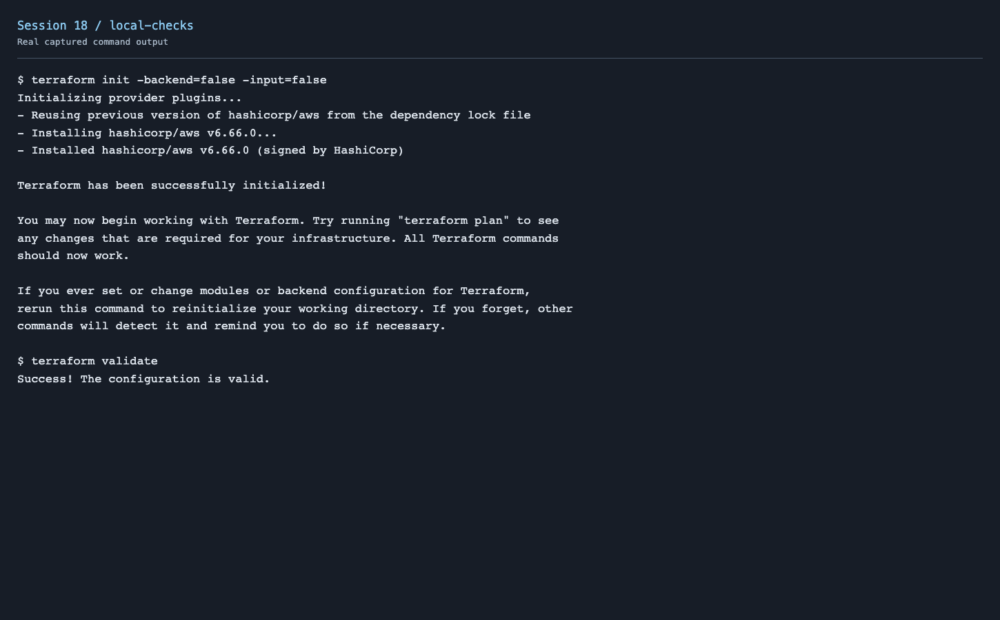

# Session 18 - Terraform S3 Demo

This project creates one private S3 bucket with a unique Terraform-generated name, blocked public access, bucket-owner-enforced ownership and SSE-S3 encryption.

Status: Terraform initialization, formatting and validation passed locally. AWS credentials are not configured yet, so cloud plan, apply, show, output and destroy are not verified.

```text
Terraform → AWS provider → S3 bucket
                           ├── Public access blocked
                           ├── Bucket ownership enforced
                           └── Default encryption
```

## Files

- `provider.tf`: Terraform version, AWS provider and Region.
- `variables.tf`: Region and bucket-name prefix.
- `terraform.tfvars`: public demo settings; contains no credentials.
- `main.tf`: bucket and its configuration resources.
- `outputs.tf`: bucket name, ARN and Region.
- `.terraform.lock.hcl`: selected provider version and checksums.

## Workflow

Configure an AWS CLI profile locally and verify it before deploying:

```bash
export AWS_PROFILE=homework
aws sts get-caller-identity
cd session18-terraform-iac/terraform-s3-demo
terraform init
terraform fmt
terraform validate
terraform plan -out=demo.tfplan
terraform apply demo.tfplan
terraform show
terraform output
terraform state list
aws s3api head-bucket --bucket "$(terraform output -raw bucket_name)"
terraform destroy
terraform state list
```

`init` installs the provider. `fmt` formats the files; `validate` checks the configuration. `plan` previews changes and saves the proposed deployment; `apply` creates it. `show` displays the current state, while `output` prints declared values. `destroy` removes resources managed by this project's state.

Terraform state maps configuration addresses to real AWS resources. Keep state and plan files out of Git; they can contain sensitive values. Keep the state available until cleanup is confirmed. The bucket starts empty, and `force_destroy = false` prevents accidentally discarding objects added later.

## Captured local checks



[Command output](screenshots/local-checks.txt)

## AWS verification pending

The real plan attempt failed with `No valid credential sources found`. [Plan output](screenshots/plan-attempt.txt). No AWS bucket has been created for this run. Successful cloud screenshots will be added after AWS access is available. Expected output examples are not presented as completed evidence.

## Research

[Five AWS service notes](../aws-services/) cover IAM, EC2, S3, VPC, DynamoDB and RDS.

Reference: [Terraform AWS S3 bucket](https://registry.terraform.io/providers/hashicorp/aws/latest/docs/resources/s3_bucket).
