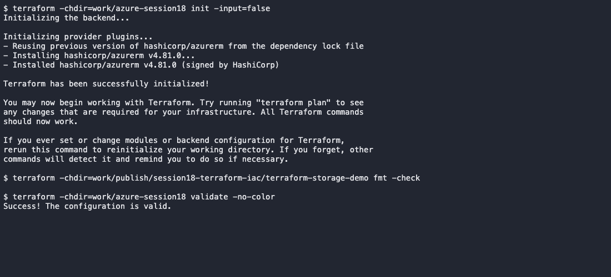
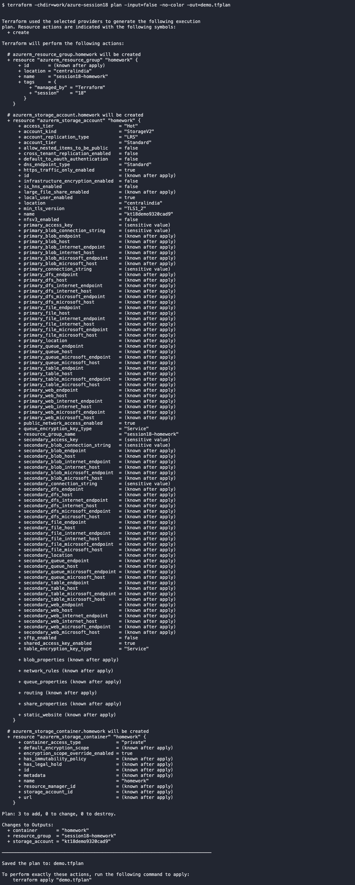
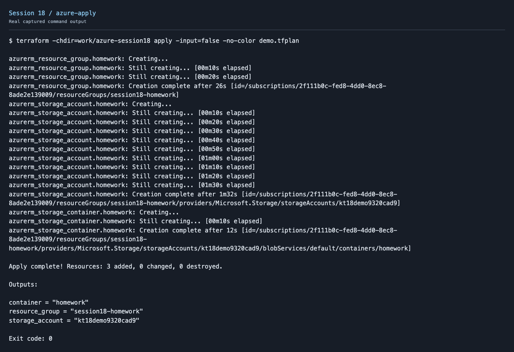
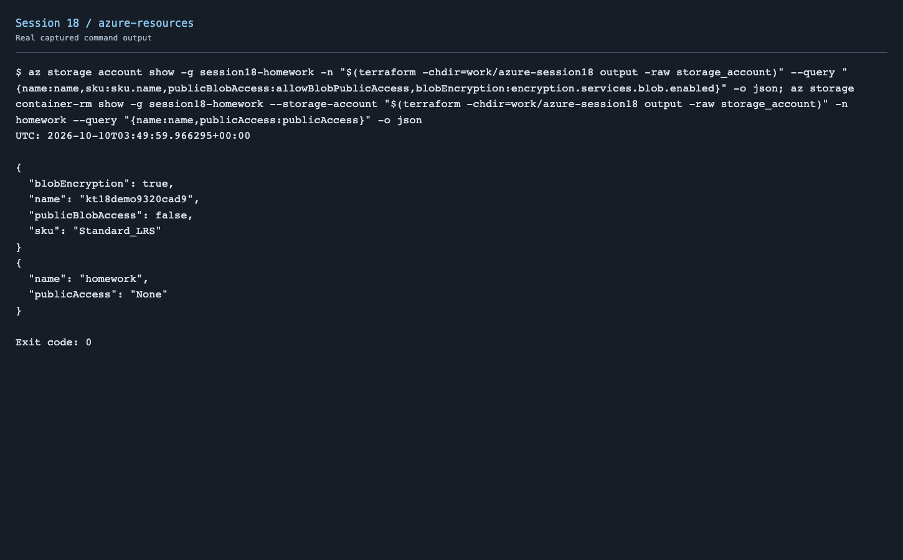
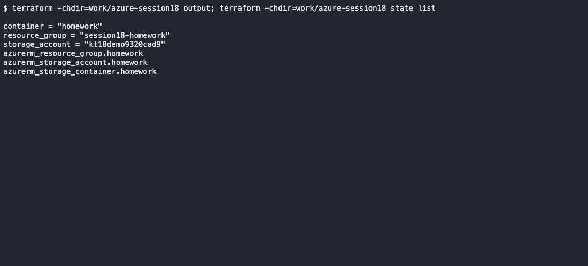
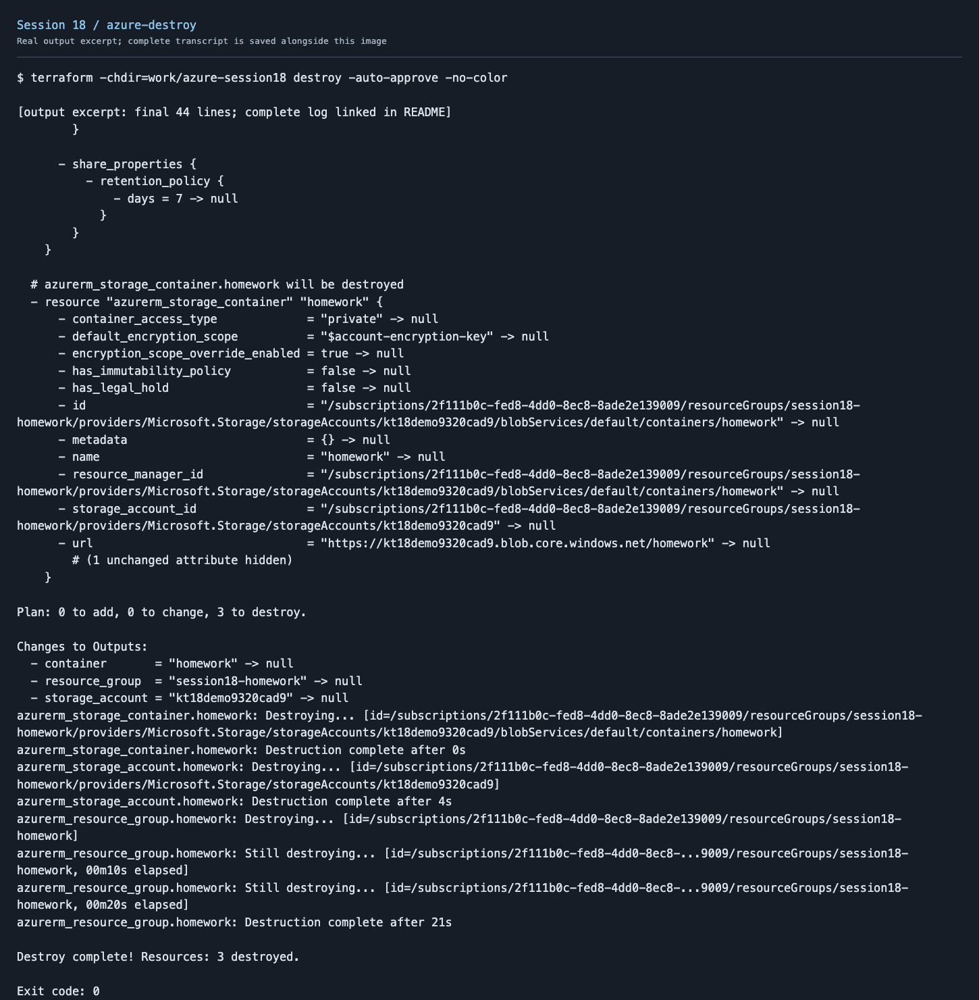

# Session 18 - Terraform Object Storage on Azure

Used Azure Blob Storage for the object-storage exercise instead of AWS S3. Terraform creates a resource group, a Standard LRS storage account and a private container. The account blocks public blob access and requires TLS 1.2.

```text
Terraform → AzureRM provider → Resource group
                                  └── Storage account (LRS / Hot)
                                      └── Private container: homework
```

## Project files

`provider.tf` selects AzureRM; `variables.tf` declares the subscription, Region and storage-account name; `main.tf` declares the resources; `outputs.tf` exposes their names. Local `terraform.tfvars` contains the actual settings. Copy the public example and fill it in before running.

## Commands

```bash
az login
cd session18-terraform-iac/terraform-storage-demo
cp terraform.tfvars.example terraform.tfvars
# Fill in your subscription ID and a globally unique storage-account name.
terraform init
terraform fmt
terraform validate
terraform plan -out=demo.tfplan
terraform apply demo.tfplan
terraform show
terraform output
terraform state list
az storage container-rm show --resource-group session18-homework \
  --storage-account "$(terraform output -raw storage_account)" --name homework
terraform destroy
terraform state list
az group exists --name session18-homework
```

`init` installs the provider. `fmt` formats the configuration; `validate` checks it. `plan` previews changes, and `apply` creates the saved plan. `show` displays state; `output` prints declared values. `destroy` removes resources tracked by this project.

The references from container to storage account and from account to resource group create implicit dependencies. Terraform creates the group first and deletes dependent resources before the group.

State maps resource addresses to Azure IDs and can contain sensitive values. State, plans, personal variable files and private keys are excluded from Git. The provider lockfile is committed.

## Output and screenshots













Full output: [init and validation](screenshots/azure-local-checks.txt), [plan](screenshots/azure-plan.txt), [apply](screenshots/azure-apply.txt), [show](screenshots/azure-show.txt), [state and outputs](screenshots/azure-state.txt), [resource verification](screenshots/azure-resources.txt), [destroy](screenshots/azure-destroy.txt), [cleanup](screenshots/azure-cleanup.txt).

## Result

Created three resources and checked that the container was private. Ran destroy after the demo. The state list was empty and the resource-group check returned false.

## Service research

[Azure service notes](../azure-services/) cover identity/RBAC, VMs, Blob Storage, VNet, Cosmos DB and managed relational databases. The AWS notes are included for comparison. Used Azure services for the deployed demo.

Reference: [AzureRM storage container](https://registry.terraform.io/providers/hashicorp/azurerm/latest/docs/resources/storage_container).
