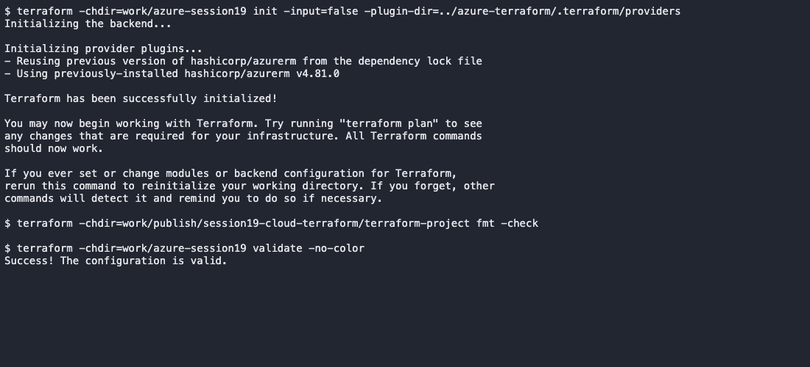
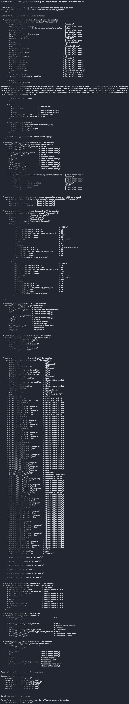
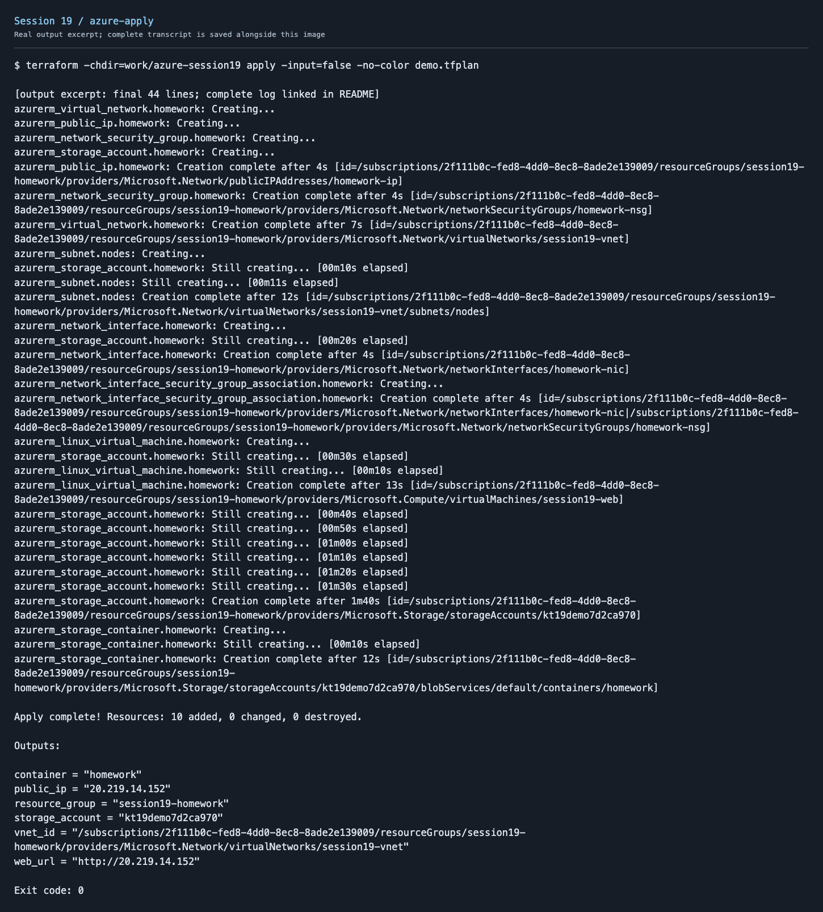
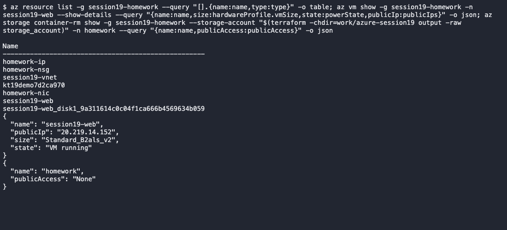
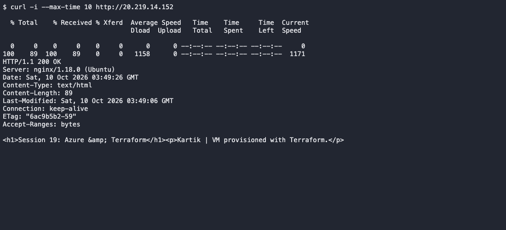
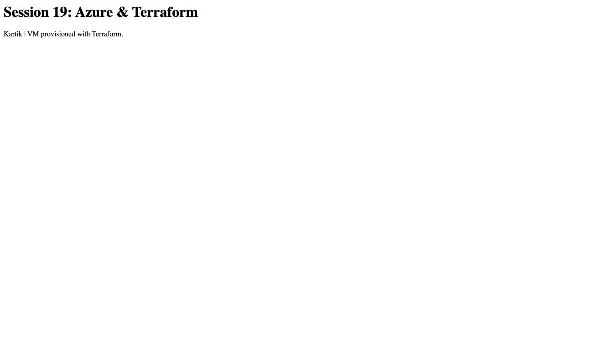
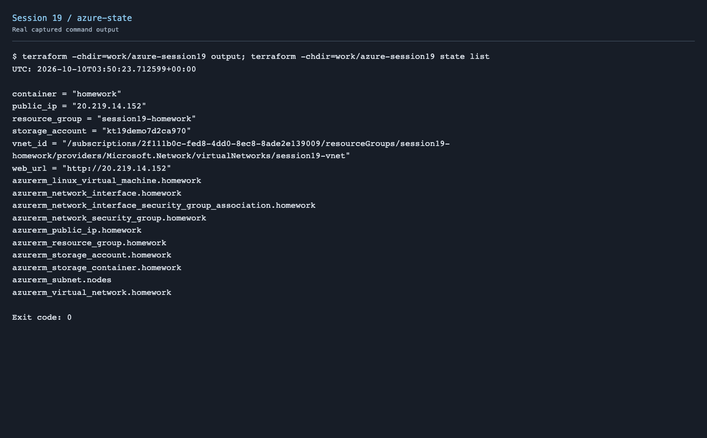
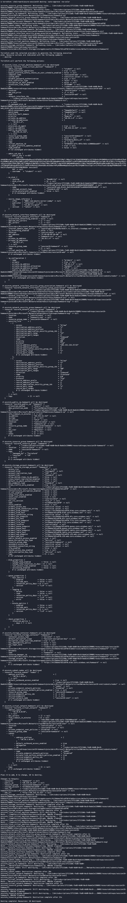

# Session 19 - Azure Cloud & Terraform in Action

Used Azure for this project instead of AWS. Terraform provisions one Ubuntu web-server VM, VNet, subnet, NSG, public IP, network interface and private Blob Storage. The lesson examples are also included in this folder.

## Architecture

```text
Terraform / AzureRM provider
    └── Resource group: session19-homework
        ├── VNet: 10.19.0.0/16
        │   └── Subnet: 10.19.1.0/24
        │       └── NIC + NSG + Public IP → Ubuntu VM → Nginx
        └── Standard LRS storage account
            └── Private container: homework
```

Azure uses system routes and an instance public IP for this setup; there is no separate AWS-style Internet Gateway resource. HTTP is allowed on port 80, and SSH is restricted to my IP. Storage is separate from the VM subnet.

## Terraform concepts

| Concept | Used here |
| --- | --- |
| Provider | AzureRM communicates with Azure APIs using the CLI login |
| Variables | Subscription, location, storage-account name, VM size, public key and administrator IP |
| Resources | Ten resources covering compute, networking and storage |
| Outputs | Resource-group name, storage/container names, VNet ID, public IP and web URL |
| Dependencies | References link resources; the VM explicitly waits for the NIC/NSG association |
| State | Maps declared resources to real Azure IDs; kept locally and excluded from Git |

[Terraform project](terraform-project/)

## Commands

```bash
az login
cd session19-cloud-terraform/terraform-project
cp terraform.tfvars.example terraform.tfvars
# Fill in the subscription, unique storage name, public key path and your IP/32.
terraform init
terraform fmt
terraform validate
terraform plan -out=demo.tfplan
terraform apply demo.tfplan
terraform show
terraform output
terraform state list
curl "$(terraform output -raw web_url)"
az vm show --resource-group session19-homework --name session19-web \
  --show-details --query '{name:name,size:hardwareProfile.vmSize,state:powerState,publicIp:publicIps}'
terraform destroy
terraform state list
az group exists --name session19-homework
```

The VM's cloud-init installs Nginx and serves the Session 19 page. Wait for startup before testing HTTP. State and plans can contain sensitive values; personal settings and private keys are also excluded from Git.

## Output and screenshots

















Full output: [local checks](screenshots/azure-local-checks.txt), [plan](screenshots/azure-plan.txt), [apply](screenshots/azure-apply.txt), [show](screenshots/azure-show.txt), [state and outputs](screenshots/azure-state.txt), [resources](screenshots/azure-resources.txt), [HTTP](screenshots/azure-http.txt), [destroy](screenshots/azure-destroy.txt), [cleanup](screenshots/azure-cleanup.txt).

## Cost and cleanup

B1 sizes were unavailable for this student subscription in Central India. I used one permitted `Standard_B2als_v2` VM, Standard LRS disk and Hot/LRS storage. There is no NAT Gateway, load balancer, Kubernetes cluster or database.

The saved Azure Retail Prices response lists Linux compute at USD 0.0246/hour. Disk, public IP, storage, network and taxes are separate. Deleted the resources after testing; the resource-group check returned false and the Terraform state was empty.

[Pricing evidence](screenshots/azure-retail-prices.json)

Created ten resources, checked the running VM and private container, then tested the web page. It returned HTTP 200. Ran destroy after the demo to remove all ten resources. Used Azure for this version of the assignment.

Reference: [Azure VM billing states](https://learn.microsoft.com/en-us/azure/virtual-machines/states-billing), [AzureRM provider](https://registry.terraform.io/providers/hashicorp/azurerm/latest/docs).
