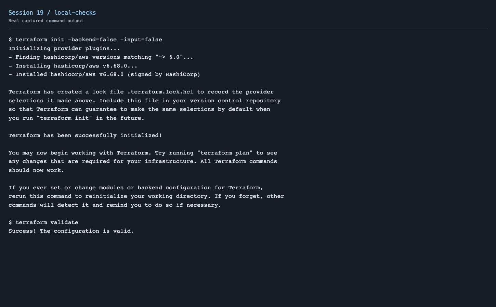

# Session 19 - Cloud & Terraform in Action

The project provisions VPC networking, an EC2 web server and a private S3 bucket. The original networking-only lessons remain unchanged; the complete project is in [terraform-project](terraform-project/).

Status: Terraform initialization, formatting and validation passed locally. Real AWS plan, apply, web-server verification and destroy are pending AWS access.

## Architecture

```text
Terraform / AWS provider
    ├── VPC: 10.20.0.0/16
    │   ├── Internet Gateway
    │   ├── Public route table: 0.0.0.0/0 → Internet Gateway
    │   └── Public subnet: 10.20.1.0/24
    │       └── EC2 web server + HTTP Security Group
    └── Private S3 bucket
```

The subnet's route table provides internet access. The Security Group allows HTTP on port 80; SSH is not exposed. EC2 user data installs Apache and serves a short Session 19 page. S3 is a separate object-storage resource, not a server inside the subnet.

## Terraform concepts

| Concept | Used here |
| --- | --- |
| Provider | `hashicorp/aws` talks to AWS APIs in the chosen Region |
| Variables | Region, instance type and bucket-name prefix |
| Resources | VPC, subnet, gateway, routes, Security Group, EC2 and S3 |
| Data sources | Available Availability Zones and an Amazon-owned Arm Linux AMI |
| Outputs | Resource IDs, bucket name and the web URL |
| Dependencies | References connect subnet/instance/group to the VPC; EC2 explicitly waits for route-table association so startup package installation has a route |
| State | Local state records real resource IDs and is excluded from Git |

## Commands

```bash
export AWS_PROFILE=homework
aws sts get-caller-identity
cd session19-cloud-terraform/terraform-project
cp terraform.tfvars.example terraform.tfvars
terraform init
terraform fmt
terraform validate
terraform plan -out=demo.tfplan
terraform apply demo.tfplan
terraform show
terraform output
terraform state list
curl "$(terraform output -raw web_url)"
aws ec2 describe-instances --instance-ids "$(terraform output -raw instance_id)"
aws s3api head-bucket --bucket "$(terraform output -raw bucket_name)"
terraform destroy
terraform state list
```

Wait for EC2 user data to finish before testing HTTP. Keep the state file until the instance, its root volume, bucket and networking are confirmed deleted. Do not run these commands in another session's Terraform directory.

## Cost choices

The planned demo uses one `t4g.nano` Arm instance, an 8 GiB encrypted gp3 root disk and one temporary public IPv4 address. CPU credits use Standard mode. There is no NAT Gateway, load balancer or database. The root disk is configured for deletion on termination. Actual account eligibility, regional availability and prices must be checked before apply; Free Tier is not assumed.

## Captured local checks



[Command output](screenshots/local-checks.txt)

## AWS execution pending

The real plan attempt failed with `No valid credential sources found`. [Plan output](screenshots/plan-attempt.txt). No resources were deployed for this run because AWS credentials are unavailable. Cloud plan, apply, resource verification and destroy screenshots remain outstanding.

References: [AWS provider](https://registry.terraform.io/providers/hashicorp/aws/latest/docs), [EC2 resource](https://registry.terraform.io/providers/hashicorp/aws/latest/docs/resources/instance), [VPC networking](https://docs.aws.amazon.com/vpc/latest/userguide/how-it-works.html).
