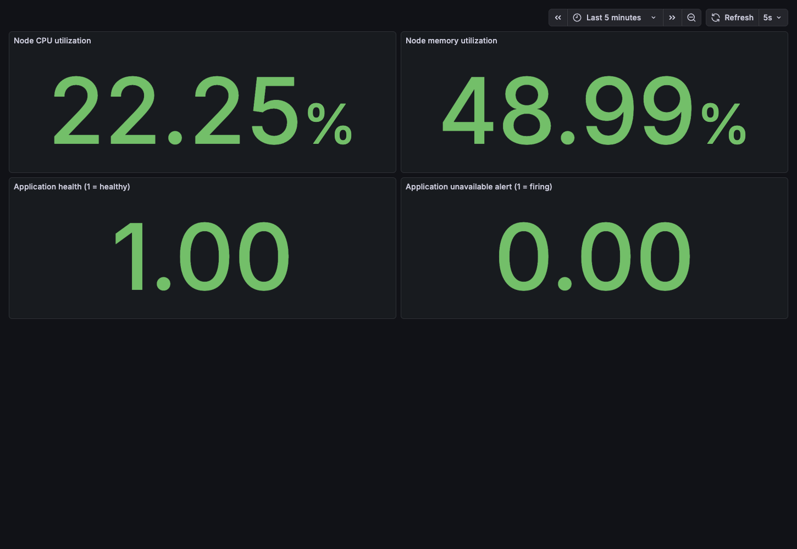
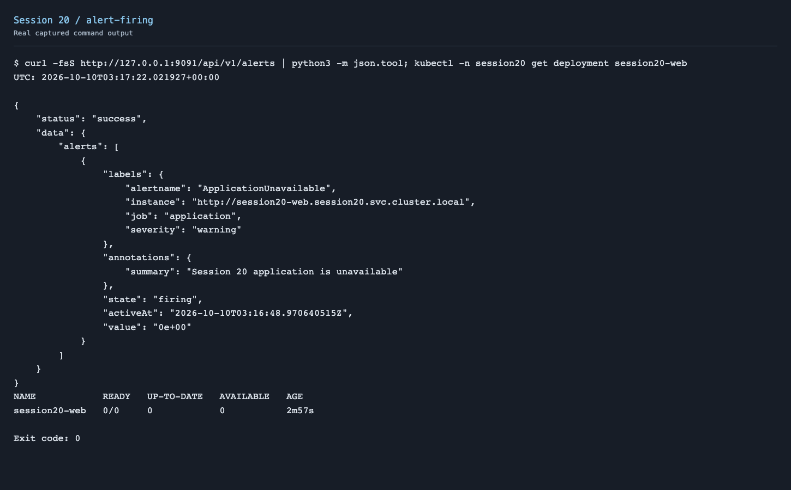
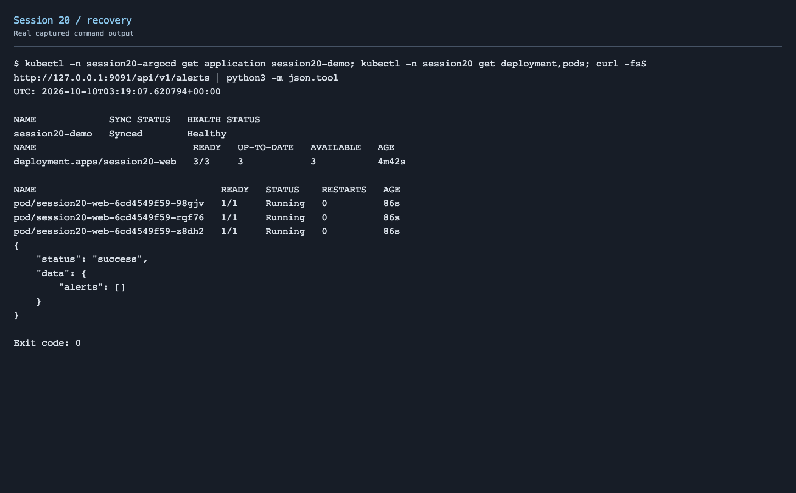
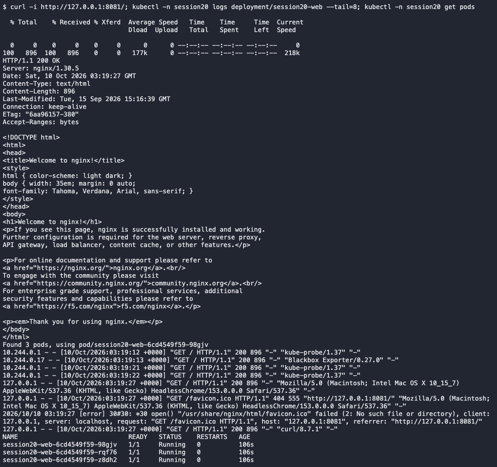
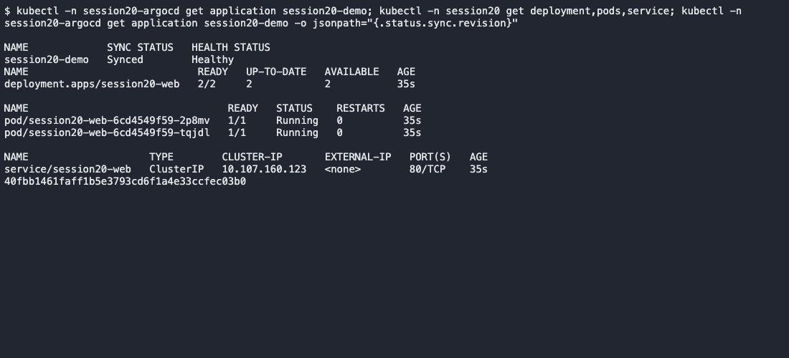
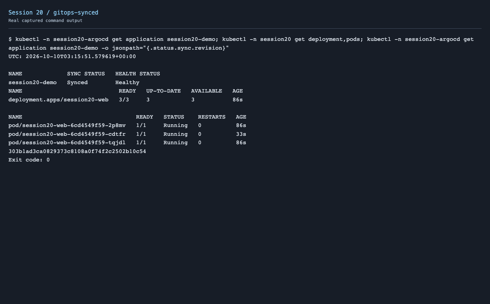
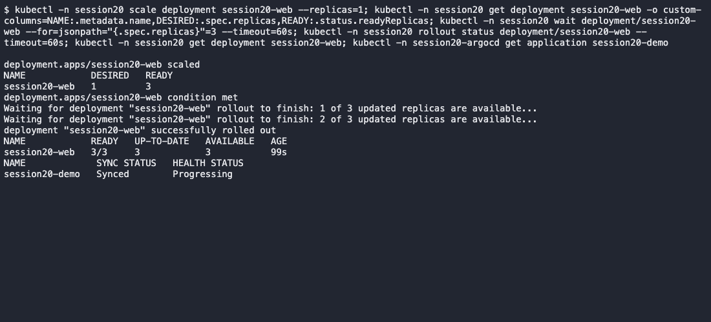

# Session 20 - Monitoring, Observability & GitOps

Used the local Minikube cluster for monitoring and GitOps. Ran Nginx with Prometheus, Grafana, Node Exporter, Blackbox Exporter and Argo CD Core.

```text
GitHub manifests → Argo CD → Kubernetes Deployment + Service
                                  ↓
Node Exporter + HTTP probe → Prometheus → Grafana
Application request logs → kubectl logs
```

## Monitoring demo

Monitoring checks whether a system is healthy using measurements, logs and alert rules.

| Check | What the demo measures |
| --- | --- |
| CPU | Percentage of node CPU time spent outside idle |
| Memory | Used memory as a percentage of total node memory |
| Application health | HTTP probe success: 1 means healthy, 0 means unavailable |
| Logs | Nginx access logs showing real HTTP requests |
| Alerts | `ApplicationUnavailable` fires after failed probes persist for 10 seconds |

The CPU and memory panels show usage inside the Linux Minikube node, not total Mac usage. Used a short alert duration to test it locally.

### Run locally

Used Git, kubectl, Minikube and Podman. The VM needed 4 GB of memory for the test, with 3 GB available to Minikube. For an existing cluster, `minikube start` reuses it.

```bash
minikube start --cpus=4 --memory=3072
cd session20-monitoring-observability-gitops
bash demo/start.sh
kubectl -n session20-argocd get applications
kubectl -n session20-monitoring get pods
```

The setup creates dedicated `session20`, `session20-monitoring` and `session20-argocd` namespaces. Argo CD Core is the headless GitOps engine; the demo uses Kubernetes commands to inspect it.

Open these in separate terminals:

```bash
kubectl -n session20-monitoring port-forward service/prometheus 9091:9090
kubectl -n session20-monitoring port-forward service/grafana 3006:3000
kubectl -n session20 port-forward service/session20-web 8081:80
```

- Application: http://localhost:8081
- Prometheus: http://localhost:9091
- Grafana dashboard: http://localhost:3006/d/session20/session-20-monitoring

Grafana has anonymous Viewer access for this local demo. No public port or cloud server is exposed.

### Queries

```promql
100 * (1 - avg(rate(node_cpu_seconds_total{mode="idle"}[1m])))
100 * (1 - node_memory_MemAvailable_bytes / node_memory_MemTotal_bytes)
probe_success{job="application"}
ALERTS{alertname="ApplicationUnavailable",alertstate="firing"}
```

[Prometheus configuration](demo/monitoring/prometheus.yml) · [Alert rule](demo/monitoring/alerts.yml) · [Dashboard](demo/monitoring/dashboard.json)

### Results

The saved dashboard shows CPU **22.25%**, memory **48.99%**, application health **1** and the recovered alert value **0**. These values belong to the capture, not a permanent baseline.



[Metric queries and results](screenshots/monitoring.json)

Committed zero replicas to test the alert. The HTTP probe failed and `ApplicationUnavailable` started firing. Committed three replicas again; the application recovered and the alert cleared.





[Alert output](screenshots/alert-firing.txt) · [Recovery output](screenshots/recovery.txt)



[HTTP and log output](screenshots/logs-health.txt) · [Browser screenshot](screenshots/application.png)

## Observability

Observability helps explain why a system is behaving badly. An availability alert identifies a failure; logs and traces help locate its cause. Combining the signals is useful when a request crosses several services or a problem cannot be reproduced locally.

| Pillar | Meaning | Example | Common tools |
| --- | --- | --- | --- |
| Metrics | Numeric measurements collected over time | CPU usage, request rate, error rate and latency | Prometheus, Grafana, CloudWatch, Azure Monitor |
| Logs | Timestamped records of events | An HTTP request or database error | kubectl logs, Loki, Elasticsearch/OpenSearch |
| Traces | A request's path through services, recorded as spans | Frontend request → API → database, with timing at each step | OpenTelemetry, Jaeger, Tempo |

In Kubernetes, monitor node and container CPU/memory, pod restarts, readiness, request failures and latency. Node Exporter provides node measurements; kubelet/cAdvisor provides container measurements; kube-state-metrics provides Kubernetes object state. Centralized logs retain evidence after pods restart. OpenTelemetry instrumentation can send application traces to a tracing backend.

This demo collects metrics and request logs. Traces are documented here; a tracing backend is not installed.

## GitOps demo

GitOps stores the desired deployment configuration in Git. A declarative manifest describes the desired state, such as three replicas. Argo CD watches the repository, compares it with Kubernetes and continuously reconciles differences.

The workflow is: edit the YAML, review the diff, commit, push, then let Argo CD synchronize. Git records who changed the configuration and supports reverting a bad change. Kubernetes runs the actual state.

[Application manifests](demo/app/) · [Argo CD Application](demo/argocd-application.yaml) · [Scoped project](demo/project.yaml)

The Application watches this repository's `demo/app` directory on `main`. `selfHeal: true` repairs drift; `prune: true` removes resources deleted from the tracked configuration. Only the demo workload directory is watched. The Application object stays outside that directory.

### Git change and reconciliation

From the repository root: the initial commit declares two replicas. Change `demo/app/deployment.yaml` to three and push:

```bash
git add session20-monitoring-observability-gitops/demo/app/deployment.yaml
git commit -m "Scale Session 20 application to three replicas"
git push origin main
kubectl -n session20-argocd get application session20-demo
kubectl -n session20 get deployment session20-web
```

### Self-healing

With Git declaring three replicas:

```bash
kubectl -n session20 scale deployment session20-web --replicas=1
kubectl -n session20 get deployment session20-web -w
```

Argo CD restored three replicas because that was the value in Git. Tested the alert separately by committing zero replicas, waiting for it to fire, then committing three replicas again.

### GitOps results

Started with two replicas in Git, changed them to three and pushed. Argo CD applied the change. Then manually scaled to one; it restored three again without running `kubectl apply` on the workload files.







[Initial sync](screenshots/gitops-initial.txt) · [Three-replica sync](screenshots/gitops-synced.txt) · [Self-healing output](screenshots/self-healing.txt)

[Scale commit and push](screenshots/git-change.txt) · [Outage commit](screenshots/alert-git-change.txt) · [Recovery commit](screenshots/recovery-git-change.txt)

## Problems encountered

| Issue | Cause | Fix |
| --- | --- | --- |
| Slow local startup and API timeouts | The existing VM had only 2 GB of RAM | Temporarily increased local memory for the demo |
| Cluster service networking failed after restart | kube-proxy could not resolve the control-plane hostname | Restarted with Minikube, then restarted kube-proxy to load the repaired mapping |
| Argo CD rejected the Application | Core installation had no default project | Created a project restricted to the demo repository and namespace |
| Grafana startup downloaded unnecessary plugins | Default plugin preinstallation was enabled | Disabled preinstallation for this dashboard |

The alert outage was deliberate and is documented as a test above.

## Cleanup

```bash
kubectl -n session20-argocd delete application session20-demo
kubectl delete namespace session20 session20-monitoring session20-argocd
```

Deleted the demo namespaces after testing and restored the local VM settings. [Cleanup output](screenshots/cleanup.txt).

## References

- [Argo CD Core](https://argo-cd.readthedocs.io/en/stable/operator-manual/core/)
- [Automated sync and self-healing](https://argo-cd.readthedocs.io/en/stable/user-guide/auto_sync/)
- [Prometheus alerting rules](https://prometheus.io/docs/prometheus/latest/configuration/alerting_rules/)
- [OpenTelemetry signals](https://opentelemetry.io/docs/concepts/signals/)

## Checks before cleanup

All three Prometheus targets were UP, the application returned HTTP 200, three replicas were ready, Argo CD reported Synced/Healthy, and the alert cleared. The setup script was rerun successfully. README links and embedded images were checked in a browser.

[Final checks](screenshots/final-verification.txt) · [Setup output](screenshots/setup-verification.txt) · [README image checks](screenshots/readme-verification.json)

## Submission

This README is the submission link. The section forms are linked from the [repository README](../README.md).
