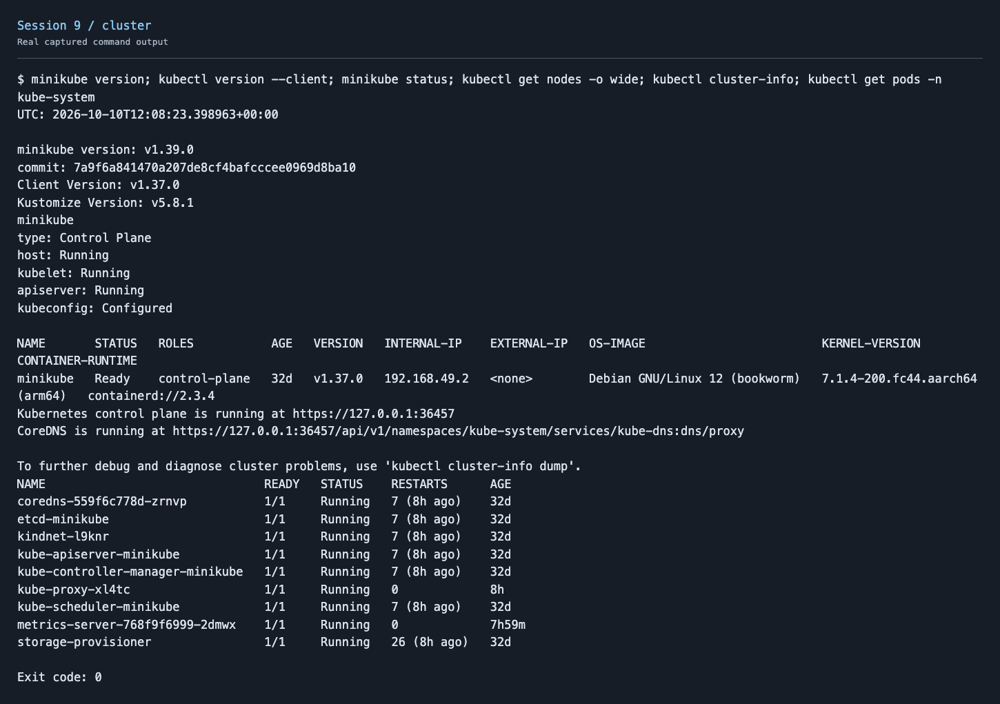
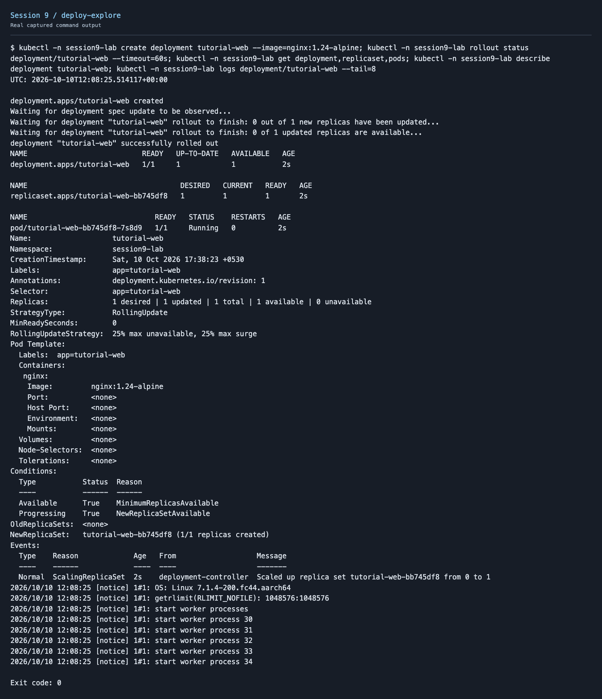
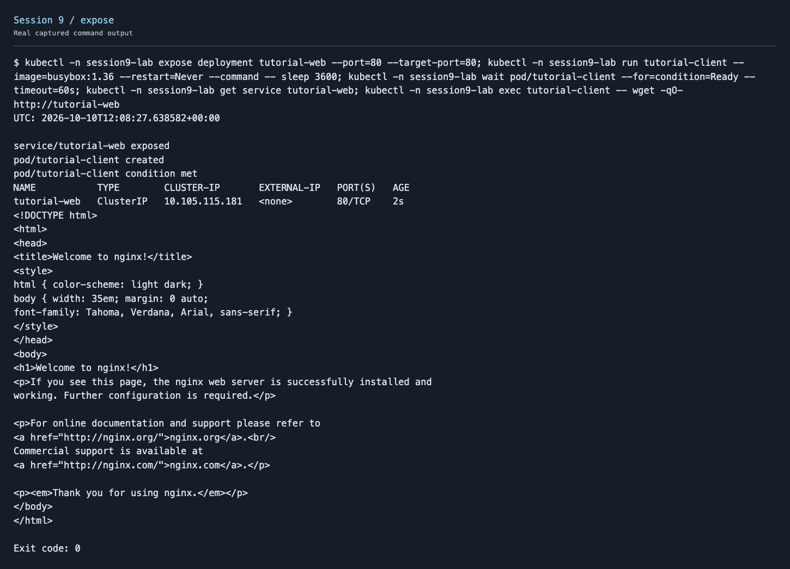
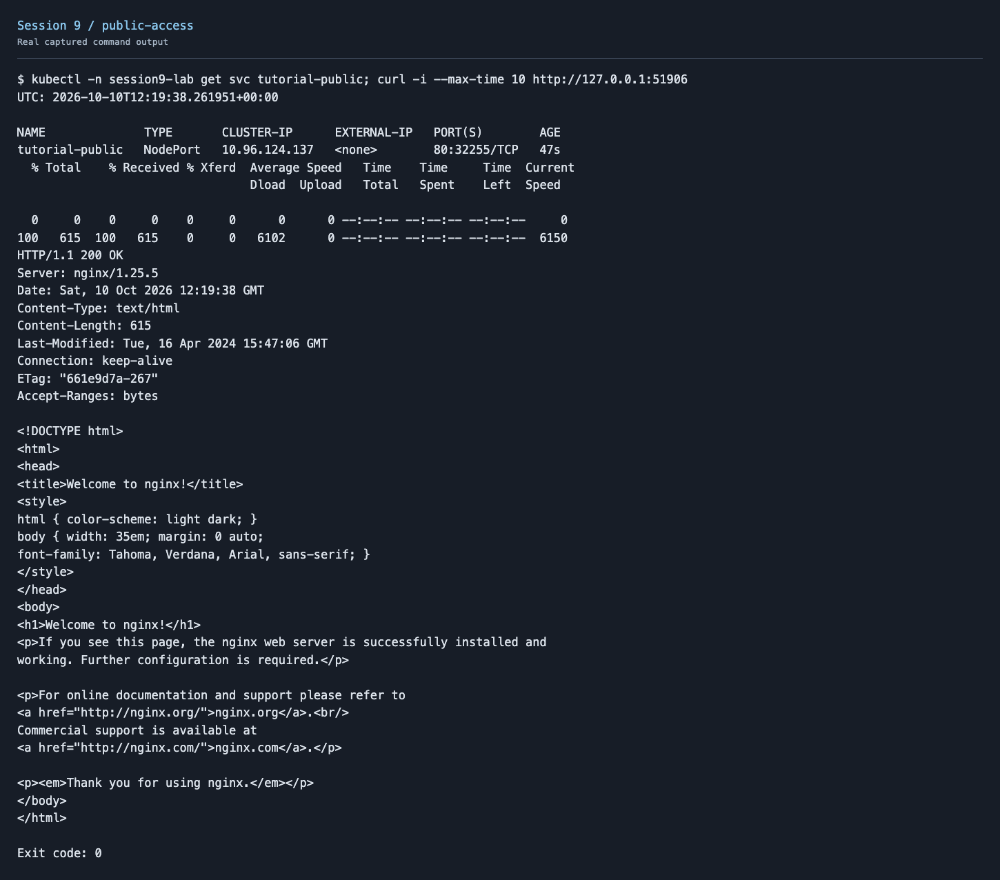
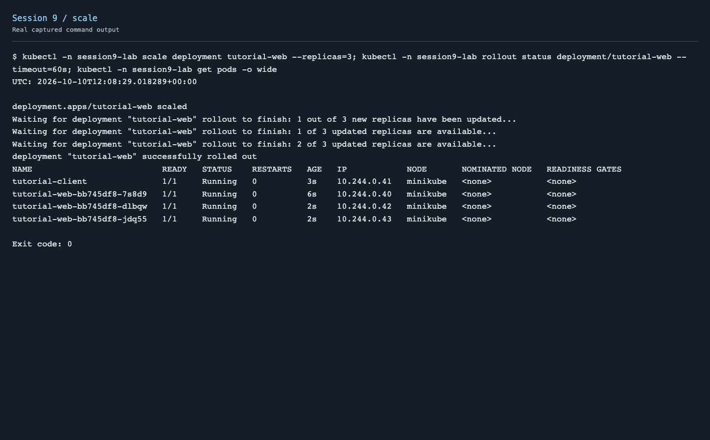
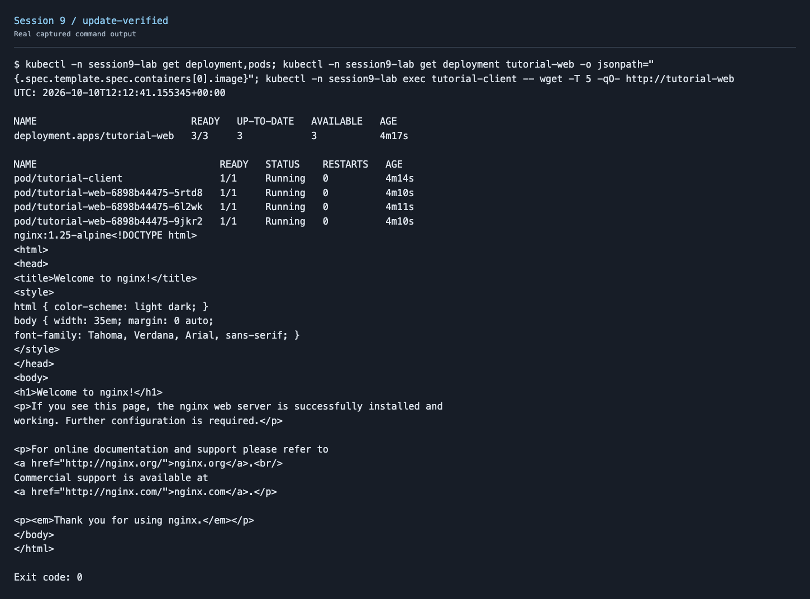

# Session 9 - Kubernetes Fundamentals

Minikube and kubectl were already installed. I verified their versions, checked the existing cluster and completed all six Kubernetes Basics modules in isolated local namespaces. I used Nginx images suitable for this Arm-based Mac.

| Module | What I did | Actual output |
| --- | --- | --- |
| Create/check cluster | Verified Minikube, node health and control-plane components | [Output](screenshots/cluster.txt) |
| Deploy app | Created a Deployment and inspected its ReplicaSet/Pods | [Output](screenshots/deploy-explore.txt) |
| Explore app | Used describe and logs | [Output](screenshots/deploy-explore.txt) |
| Expose app | Created/tested a Service, then a NodePort accessed from the Mac through Minikube | [Internal](screenshots/expose.txt), [public](screenshots/public-access.txt) |
| Scale app | Scaled from one to three ready replicas | [Output](screenshots/scale.txt) |
| Update app | Updated Nginx 1.24-alpine to 1.25-alpine and verified the page | [Output](screenshots/update-verified.txt) |

## Screenshots













A request immediately after the update timed out. A later check returned the page successfully; [the first attempt](screenshots/update.txt) is retained alongside the successful verification.

## Architecture notes

The API server accepts Kubernetes requests; etcd stores cluster state. The scheduler assigns Pods to nodes, and controllers reconcile desired state. The kubelet runs containers through the container runtime. kube-proxy programs Service traffic rules; CoreDNS provides name discovery.

A Deployment manages application releases through ReplicaSets. A ReplicaSet maintains Pod count. Pods run containers, and Services supply stable endpoints for reaching them.

```text
kubectl → API server → controllers/scheduler → node kubelet → containers
             ↕                                  ↑
            etcd                         Service network / CoreDNS
```

The existing shared cluster was reused and kept running. Only the homework namespaces were removed after testing. [Cleanup output](screenshots/cleanup.txt).

Reference: [Kubernetes Basics tutorial](https://kubernetes.io/docs/tutorials/kubernetes-basics/).
